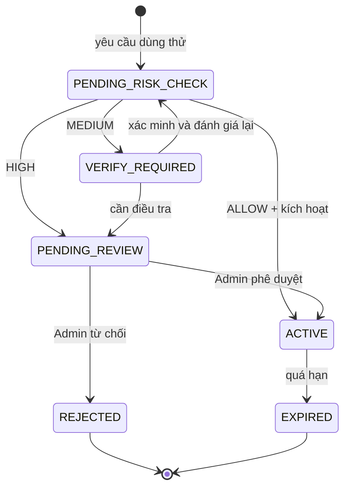
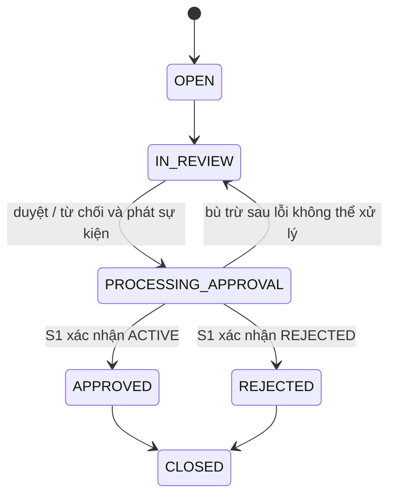
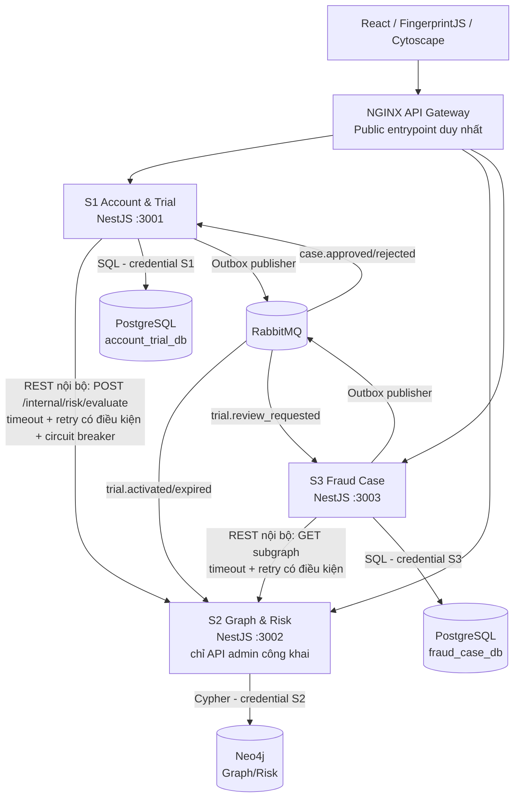
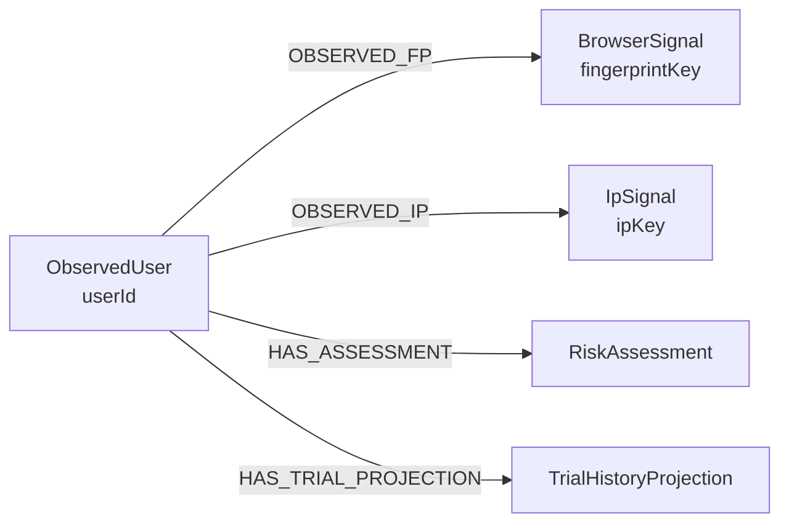
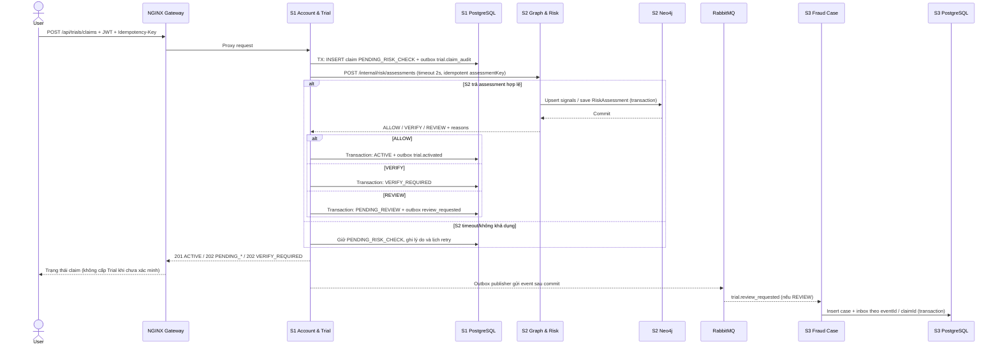
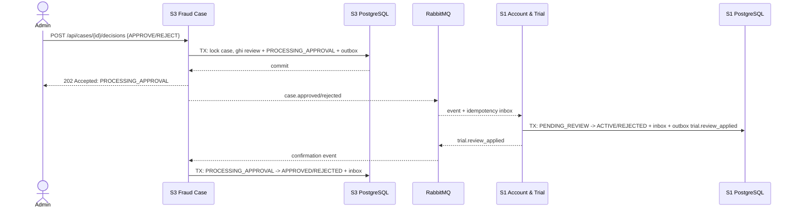

# TÀI LIỆU ĐỀ XUẤT VÀ THIẾT KẾ HỆ THỐNG

# Hệ thống phát hiện gian lận đa tài khoản bằng Browser Fingerprinting và Graph Analysis

**Tên tiếng Anh:** Multi-Account Fraud Detection System Using Browser Fingerprinting & Graph Analysis  
**Phiên bản tài liệu:** 2.0 — 03/11/2026 (điều chỉnh theo đề bài giảng viên)  
**Môn học:** Phát triển phần mềm hướng dịch vụ (SOA)  
**Quy mô:** Nhóm 2 sinh viên; **03 microservice nghiệp vụ**  
**Backend:** NestJS + TypeScript  
**CSDL theo quyền sở hữu:** PostgreSQL (S1 và S3, 2 database độc lập) + Neo4j Community (S2)  
**Frontend:** React + TypeScript  
**Giao tiếp:** REST/HTTP đồng bộ và RabbitMQ bất đồng bộ  
**Phạm vi triển khai:** Đồ án/MVP minh họa, không phải hệ thống xác minh danh tính hoặc chống gian lận thương mại ở cấp production.  
**Tài liệu căn cứ:** `bai-tap-lon-yeu-cau-gui-sinh-vien_1.docx` — yêu cầu bắt buộc 1–8, điểm cộng, sản phẩm nộp và quy định bảo vệ.

> **Ghi chú cập nhật (06/11/2026):** Đây là tài liệu phiên bản cũ. Thiết kế chốt hiện hành là bản v4 (`Thiet_ke_he_thong_phat_hien_gian_lan_da_tai_khoan_v4_auto100.md`). Nội dung mật khẩu đã được đồng bộ theo triển khai: **bcrypt 12 rounds**; lý do và đánh đổi ghi tại v4 §13.2.

---

## MỤC LỤC

1. [Tóm tắt kiến trúc chốt theo yêu cầu giảng viên](#1-tóm-tắt-kiến-trúc-chốt-theo-yêu-cầu-giảng-viên)
2. [Bối cảnh, vấn đề và mục tiêu](#2-bối-cảnh-vấn-đề-và-mục-tiêu)
3. [Thuật ngữ và nguyên tắc phát hiện gian lận](#3-thuật-ngữ-và-nguyên-tắc-phát-hiện-gian-lận)
4. [Phạm vi và tác nhân](#4-phạm-vi-và-tác-nhân)
5. [Danh sách chức năng](#5-danh-sách-chức-năng)
6. [Quy tắc nghiệp vụ và vòng đời trạng thái](#6-quy-tắc-nghiệp-vụ-và-vòng-đời-trạng-thái)
7. [Kiến trúc tổng thể và phân chia service](#7-kiến-trúc-tổng-thể-và-phân-chia-service)
8. [Công nghệ và lý do lựa chọn](#8-công-nghệ-và-lý-do-lựa-chọn)
9. [Thiết kế dữ liệu độc lập PostgreSQL và Neo4j](#9-thiết-kế-dữ-liệu-độc-lập-postgresql-và-neo4j)
10. [Browser Fingerprinting](#10-browser-fingerprinting)
11. [Graph Analysis và Fraud Risk Scoring](#11-graph-analysis-và-fraud-risk-scoring)
12. [Luồng nghiệp vụ nhiều bước và xử lý lỗi giữa chừng](#12-luồng-nghiệp-vụ-nhiều-bước-và-xử-lý-lỗi-giữa-chừng)
13. [Đặc tả REST API, lỗi nghiệp vụ và OpenAPI](#13-đặc-tả-rest-api-lỗi-nghiệp-vụ-và-openapi)
14. [Giao tiếp tin cậy, RabbitMQ, Timeout/Retry và Circuit Breaker](#14-giao-tiếp-tin-cậy-rabbitmq-timeoutretry-và-circuit-breaker)
15. [Thiết kế giao diện](#15-thiết-kế-giao-diện)
16. [Bảo mật, quyền riêng tư và phi chức năng](#16-bảo-mật-quyền-riêng-tư-và-phi-chức-năng)
17. [Kiểm thử, Postman và hai thử nghiệm lỗi có số liệu](#17-kiểm-thử-postman-và-hai-thử-nghiệm-lỗi-có-số-liệu)
18. [Kế hoạch 8 tuần và phân chia cho nhóm 2 người](#18-kế-hoạch-8-tuần-và-phân-chia-cho-nhóm-2-người)
19. [Source tree, Docker Compose và khởi chạy một lệnh](#19-source-tree-docker-compose-và-khởi-chạy-một-lệnh)
20. [Rủi ro, giới hạn và hướng mở rộng](#20-rủi-ro-giới-hạn-và-hướng-mở-rộng)
21. [Sản phẩm nộp, đánh giá và Definition of Done](#21-sản-phẩm-nộp-đánh-giá-và-definition-of-done)
22. [Tài liệu tham khảo](#22-tài-liệu-tham-khảo)

Phụ lục: [A. Sprint ưu tiên](#phụ-lục-a--thứ-tự-ưu-tiên-khi-bắt-đầu-code) · [B. Quyết định thiết kế](#phụ-lục-b--kiểm-tra-chéo-quyết-định-thiết-kế) · [C. Ma trận 8 yêu cầu](#phụ-lục-c--ma-trận-truy-vết-8-yêu-cầu-bắt-buộc-requirement-traceability-matrix) · [D. Kiểm tra trước khi nộp](#phụ-lục-d--quy-trình-đánh-giá-dự-án-trước-khi-nộp)

---

## 1. Tóm tắt kiến trúc chốt theo yêu cầu giảng viên

### 1.1. Công nghệ sử dụng

| Thành phần | Công nghệ chốt | Ghi chú |
|---|---|---|
| Frontend | React + TypeScript + Vite + Ant Design | Trang User và Dashboard Admin |
| Backend nghiệp vụ | **NestJS + TypeScript (03 service)** | Nhóm 2 người cần tối thiểu 02; dùng 03 để phân rõ trách nhiệm |
| API Gateway | **NGINX** | Điểm vào duy nhất cho public API; không thực hiện logic gian lận |
| S1 Account & Trial | **PostgreSQL, database `account_trial_db`** | Chỉ S1 có credential truy cập |
| S2 Graph & Risk | **Neo4j Community, instance riêng của S2** | Chỉ S2 có credential truy cập |
| S3 Fraud Case | **PostgreSQL, database `fraud_case_db`** | Chỉ S3 có credential truy cập |
| Message broker | RabbitMQ | Luồng phụ bất đồng bộ, consumer idempotent + DLQ |
| Browser Fingerprinting | FingerprintJS OSS | Tín hiệu rủi ro, không phải danh tính chắc chắn |
| Graph UI | Cytoscape.js | Hiển thị mạng liên kết giữa các tài khoản |
| Authentication | JWT + bcrypt | NestJS Guards xác thực; JWT ngay tại NGINX là mục cộng riêng, *chưa chốt* |
| Triển khai | Dockerfile từng service + `docker-compose.yml` | Chạy bằng `docker compose up` từ thư mục gốc |
| API Contract | OpenAPI 3.x, một `.yaml`/service | Có thể sinh với `@nestjs/swagger` rồi xuất tệp |
| Testing / CI | Postman, Jest/Supertest, GitHub Actions | Postman ≥10 request; CI là mục cộng |
| Circuit breaker | Client-side circuit breaker tại S1 khi gọi S2 | Thử nghiệm OPEN/HALF_OPEN/CLOSED là mục cộng |
| Redis / Kafka / ML | **Không dùng trong MVP** | Tránh quá tải nhóm 2 người |

**Không dùng chung một database giữa các service:** hai database PostgreSQL có thể chạy chung một *PostgreSQL server/container*, nhưng phải có database, user và quyền riêng; Neo4j là store của S2. Không một service nào chạy SQL/Cypher trên database của service khác. Dữ liệu liên quan được đồng bộ bằng API/event và projection nội bộ.

### 1.2. Ranh giới ba service

1. **S1 — Account & Trial Service:** đăng ký, JWT, Campaign, TrialClaim và cấp/quản lý quyền dùng thử. Sở hữu `account_trial_db`.
2. **S2 — Graph & Risk Service:** nhận tín hiệu thiết bị/IP, xây dựng đồ thị liên kết, lưu assessment, truy vấn cụm và tính RiskScore. Sở hữu Neo4j.
3. **S3 — Fraud Case Service:** nhận sự kiện yêu cầu review, lưu hồ sơ, xét duyệt, audit, báo cáo. Sở hữu `fraud_case_db`.

**Vì sao chia như vậy?** S1 thực thi quyết định cấp ưu đãi và đảm bảo transaction; S2 tập trung thuật toán/đồ thị có kiểu dữ liệu khác biệt; S3 là quy trình xét duyệt bất đồng bộ với vòng đời riêng. Service không được tách chỉ vì mỗi chức năng CRUD.

### 1.3. Phạm vi cần ưu tiên để đạt yêu cầu môn học

**MUST trước khi thêm thuật toán nâng cao:** Business Rules ≥5; ≥4 REST endpoint/service, trong đó ≥1 endpoint trả 4xx nghiệp vụ; OpenAPI riêng; API Gateway duy nhất; `GET /health` mỗi service; REST call timeout + retry có quy tắc; phân biệt 4xx/503/504; luồng nhiều bước giữ PENDING khi không biết kết quả; Dockerfile/Compose; Postman ≥10 request; 2 thử nghiệm tắt/chậm service có đo số liệu.

**Điểm cộng ưu tiên:** (1) RabbitMQ với consumer idempotent + DLQ (+0,5), (2) Circuit Breaker (+0,25), (3) CI chạy test tự động (+0,25). Tổng điểm cộng toàn bài tối đa **+1,0**, dù các mục cộng riêng cộng số học có thể vượt ngưỡng này. JWT kiểm tra **tại Gateway** (+0,25) chỉ nhận nếu thực sự triển khai tại Gateway; NestJS Guard không thay thế được yêu cầu đó.

### 1.4. Trạng thái tài liệu

Tệp này là **bản phân tích/thiết kế và kế hoạch triển khai**, không tự chứng minh hệ thống đã chạy. Những yêu cầu như tệp OpenAPI, source Git, Dockerfile, Postman collection, PDF ≥30 trang, số liệu lỗi và slide ≤10 trang được ghi thành **deliverable phải tạo và kiểm chứng** trong các giai đoạn thực hiện.

> **Cập nhật v4 — auto 100%:** Luồng quyết định không còn admin review trong critical path. S3 được đặc tả lại thành **Fraud Case & Investigation Service** với auto-triage, ghép cụm, severity P1/P2/P3, audit append-only và retention. Bản chốt đầy đủ nằm ở `Thiet_ke_he_thong_phat_hien_gian_lan_da_tai_khoan_v4_auto100.md`; đặc tả S3 chi tiết nằm ở `S3_Case_Investigation_Service.md`. Các mục 5.3, 6.3, 9.4, 12.2, 13.4 và 15.2 trong tài liệu này được thay thế bởi v4.

---

## 2. Bối cảnh, vấn đề và mục tiêu

### 2.1. Bối cảnh kinh doanh

Giả sử công ty cung cấp ứng dụng AI có gói Premium dùng thử 7 ngày cho người dùng mới. Một người dùng có thể đăng ký nhiều tài khoản để liên tục nhận ưu đãi thay vì trả phí.

Một số biểu hiện cần giám sát:

- Nhiều tài khoản được tạo từ cùng môi trường trình duyệt trong thời gian ngắn.
- Một cụm tài khoản cùng nhận nhiều lần chương trình dùng thử.
- Các tài khoản sử dụng email/IP khác nhau nhưng có mối liên hệ kỹ thuật hoặc hành vi đáng ngờ.
- Một nhóm tài khoản thay phiên nhận dùng thử sau khi tài khoản trước hết hạn.

Ví dụ dữ liệu **giả lập**:

| Tài khoản | Fingerprint | IP | Đăng ký | Trial |
|---|---|---|---|---|
| U01 | FP-A | IP-1 | 09:00 | ACTIVE |
| U02 | FP-A | IP-2 | 09:05 | EXPIRED |
| U03 | FP-A | IP-3 | 09:12 | PENDING |
| U04 | FP-B | IP-1 | 10:00 | NONE |

U01–U03 có cùng fingerprint; U04 chỉ trùng IP. Không được kết luận tất cả là cùng người.

### 2.2. Mục tiêu kinh doanh

- Giảm khả năng lạm dụng chương trình dùng thử.
- Không từ chối nhầm tài khoản hợp lệ chỉ vì trùng IP/fingerprint.
- Cho quản trị viên thấy **bằng chứng và lý do** đằng sau điểm rủi ro.
- Tạo quy trình xét duyệt rõ ràng, có khả năng giải trình và kiểm toán.

### 2.3. Mục tiêu kỹ thuật của môn SOA

- Xây dựng 03 service có trách nhiệm rõ ràng.
- REST cho đánh giá phải trả lời ngay; RabbitMQ cho sự kiện bất đồng bộ.
- Dữ liệu đồ thị và truy vấn quan hệ nhiều bước bằng Neo4j/Cypher.
- Tích hợp outbox/inbox, idempotency, retry và dead-letter queue ở mức khả thi.
- Có Docker Compose, tài liệu API, kịch bản kiểm thử tích hợp.

### 2.4. Phạm vi KHÔNG triển khai

- Xác định danh tính thực của một con người với độ chính xác tuyệt đối.
- Theo dõi người dùng trên các website khác nhau.
- Thu thập IMEI, serial phần cứng hoặc MAC address từ trình duyệt.
- Tích hợp thanh toán thật, KYC thật hoặc dữ liệu cá nhân nhạy cảm của người dùng thật.
- Điều tra gian lận sản xuất quy mô lớn, ML production, xử lý hàng triệu sự kiện/giây.
- Tự động cấm vĩnh viễn chỉ vì trùng fingerprint.

---

## 3. Thuật ngữ và nguyên tắc phát hiện gian lận

| Thuật ngữ | Ý nghĩa |
|---|---|
| Multi-account abuse | Lạm dụng việc sở hữu nhiều tài khoản để nhận ưu đãi/tránh giới hạn |
| Browser fingerprint | Tín hiệu định danh tương đối của môi trường trình duyệt |
| Visitor ID | Chuỗi định danh mà thư viện FingerprintJS tính ở phía trình duyệt |
| Signal | Dấu hiệu như fingerprint, IP, thời điểm, lịch sử nhận trial |
| Entity linking | Liên kết tài khoản dựa trên các tín hiệu chung |
| Graph traversal | Truy vấn đi qua nhiều mối quan hệ trong đồ thị |
| Cluster | Nhóm tài khoản có mối liên hệ trong dữ liệu; chưa khẳng định gian lận |
| Risk score | Điểm nguy cơ dựa trên quy tắc minh họa, không phải xác suất khoa học |
| False positive | Người dùng hợp lệ bị đánh dấu đáng ngờ |
| Case | Hồ sơ cần quản trị viên xem xét |
| Idempotency | Xử lý lặp lại cùng yêu cầu/sự kiện không tạo tác dụng lặp |
| Outbox | Lưu ý định phát sự kiện cùng transaction nghiệp vụ để phát lại an toàn |

**Nguyên tắc cốt lõi:** Một dấu hiệu đơn lẻ như cùng IP hoặc cùng fingerprint **không chứng minh** hai tài khoản thuộc cùng một người hay có hành vi gian lận.

---

## 4. Phạm vi và tác nhân

### 4.1. Tác nhân

| Tác nhân | Mô tả |
|---|---|
| Guest | Truy cập website, đăng ký tài khoản |
| User | Đăng nhập, yêu cầu dùng thử, xem trạng thái, gửi yêu cầu xem xét |
| Admin/Reviewer | Xem các case, quan hệ tài khoản, duyệt/từ chối, ghi lý do |
| System | Thu tín hiệu, tính điểm rủi ro, phát sự kiện, cập nhật trạng thái |

### 4.2. Ca sử dụng chính

| ID | Use case | Tác nhân |
|---|---|---|
| UC-01 | Đăng ký tài khoản | Guest |
| UC-02 | Xác minh email (có thể mock OTP ở MVP) | User |
| UC-03 | Đăng nhập và đăng xuất | User |
| UC-04 | Yêu cầu nhận Trial | User |
| UC-05 | Thu Browser Fingerprint | System |
| UC-06 | Liên kết tài khoản theo tín hiệu | System |
| UC-07 | Tính Fraud Risk Score | System |
| UC-08 | Quyết định cấp/giữ Trial | System |
| UC-09 | Xem trạng thái Trial và lý do cần xác minh | User |
| UC-10 | Xem danh sách tài khoản/case đáng ngờ | Admin |
| UC-11 | Xem đồ thị quan hệ | Admin |
| UC-12 | Xem xét và phê duyệt/từ chối | Admin |
| UC-13 | Theo dõi lịch sử và dashboard | Admin |
| UC-14 | Kiểm thử sự kiện, retry, chống xử lý trùng | Developer/Admin demo |

---

## 5. Danh sách chức năng

**Mức ưu tiên:** `MUST` = bắt buộc MVP; `SHOULD` = nên làm; `COULD` = nâng cao. Mọi service còn bắt buộc có `GET /health`, ≥4 REST endpoints, OpenAPI file riêng, Dockerfile riêng, DB credentials riêng.

### 5.1. Account & Trial Service (S1)

| ID | Module | Chức năng | Ưu tiên |
|---|---|---|---|
| A01 | Account | Đăng ký với email, mật khẩu | MUST |
| A02 | Auth | Đăng nhập JWT, hash mật khẩu bcrypt | MUST |
| A03 | Account | Xác minh email bằng mã demo | SHOULD |
| A04 | Account | Xem thông tin tài khoản | MUST |
| A05 | Trial | Xem chương trình dùng thử đang hoạt động | MUST |
| A06 | Trial | Yêu cầu nhận Trial | MUST |
| A07 | Trial | Ngăn kích hoạt lặp cho cùng user/campaign | MUST |
| A08 | Trial | Gửi yêu cầu phân tích rủi ro tới S2 | MUST |
| A09 | Trial | Xử lý quyết định ALLOW/VERIFY/REVIEW | MUST |
| A10 | Trial | Kích hoạt / hết hạn / từ chối Trial | MUST |
| A11 | Trial | Áp dụng quyết định duyệt từ S3 qua sự kiện | SHOULD |
| A12 | Event | PostgreSQL outbox/inbox; phát `trial.*`, `trial.review_requested`, luồng phụ `trial.claim_audit` | MUST |
| A13 | Trial | Xác minh bổ sung bằng mã demo khi claim `VERIFY_REQUIRED`; tái đánh giá risk phiên bản mới | MUST |

### 5.2. Graph & Risk Service (S2)

| ID | Module | Chức năng | Ưu tiên |
|---|---|---|---|
| G01 | Evidence | Nhận fingerprint và IP ở thời điểm yêu cầu | MUST |
| G02 | Evidence | HMAC các khóa nhận diện trước khi lưu | MUST |
| G03 | Graph | Tạo/cập nhật node và relationship | MUST |
| G04 | Graph | Tìm tài khoản chung fingerprint | MUST |
| G05 | Graph | Tìm tài khoản chung IP, có giới hạn tần suất/khoảng thời gian | MUST |
| G06 | Graph | Truy vấn mối quan hệ tối đa 2–3 bước | MUST |
| G07 | Fraud | Tính feature và Risk Score | MUST |
| G08 | Fraud | Trả `score`, `decision`, `reasons`, `assessmentId` | MUST |
| G09 | Fraud | Duy trì projection lịch sử Trial trong Neo4j từ `trial.activated`/`trial.expired` | MUST |
| G10 | Graph | Hiển thị subgraph theo tài khoản | MUST |
| G11 | Graph | Tìm nhóm ứng viên (candidate clusters) | SHOULD |
| G12 | Fraud | Cấu hình rule và trọng số | SHOULD |
| G13 | Event | Phát `risk.assessed` (sự kiện quan sát, không dùng trực tiếp tạo case) | COULD |
| G14 | Explainability | Giải thích vì sao bị tăng điểm | MUST |
| G15 | Advanced | WCC / thuật toán community detection | COULD |

### 5.3. Fraud Case Service (S3)

| ID | Module | Chức năng | Ưu tiên |
|---|---|---|---|
| C01 | Case | Tạo case trong PostgreSQL từ `trial.review_requested` sau khi claim đã PENDING_REVIEW | MUST |
| C02 | Case | Danh sách case và bộ lọc | MUST |
| C03 | Case | Xem chi tiết và lý do rủi ro | MUST |
| C04 | Case | Hiển thị subgraph lấy từ S2 | MUST |
| C05 | Review | Phê duyệt quyền dùng thử | MUST |
| C06 | Review | Từ chối yêu cầu có ghi lý do | MUST |
| C07 | Review | Chống duyệt 2 lần, kiểm tra trạng thái hợp lệ | MUST |
| C08 | Event | PostgreSQL outbox/inbox; phát `case.approved/rejected`; nhận `trial.review_applied` | MUST |
| C09 | Dashboard | Thống kê số case, phân bố mức độ rủi ro | SHOULD |
| C10 | Audit | Lưu người duyệt, thời điểm, ghi chú | MUST |
| C11 | Appeal | Tiếp nhận yêu cầu xem xét lại | COULD |
| C12 | Audit | Ghi sự kiện `trial.claim_audit` vào bảng audit qua luồng phụ RabbitMQ | MUST |

---

## 6. Quy tắc nghiệp vụ và vòng đời trạng thái

### 6.1. Business Rules

| Mã | Quy tắc |
|---|---|
| BR-01 | Mỗi email chuẩn hóa chỉ có tối đa một tài khoản trong hệ thống demo. |
| BR-02 | Người dùng phải đăng nhập mới có thể yêu cầu Trial. |
| BR-03 | Một user chỉ có tối đa một TrialClaim cho cùng campaign; dùng khóa duy nhất `userId:campaignId`. |
| BR-04 | Tài khoản đã nhận Trial của campaign sẽ không được nhận lại dưới cùng user. |
| BR-05 | Fingerprint là tín hiệu bổ trợ; không được tự động từ chối chỉ vì trùng fingerprint. |
| BR-06 | IP chỉ là tín hiệu yếu; IP chung ở trường học/công ty không mặc nhiên là gian lận. |
| BR-07 | Kết quả phân tích rủi ro phải có lý do (`reasons`) để Admin xem. |
| BR-08 | Nếu S2 không phản hồi, không mặc định cấp Trial; trạng thái `PENDING_RISK_CHECK`, cho phép retry. |
| BR-09 | `LOW` -> `ACTIVE`; `MEDIUM` -> `VERIFY_REQUIRED`; `HIGH` -> `PENDING_REVIEW` (ngưỡng demo). |
| BR-10 | Admin chỉ được duyệt/từ chối các case đang chờ; phải có quyền `ADMIN`. |
| BR-11 | Quyết định review phải ghi actor/time/reason, không sửa hoặc xóa lịch sử. |
| BR-12 | Sự kiện RabbitMQ có thể nhận lặp; consumer phải idempotent theo `eventId`. |
| BR-13 | Gửi cùng một TrialClaim request lặp lại phải trả về kết quả hiện tại, không tạo Trial thứ hai. |
| BR-14 | Tài khoản đang chờ review không được sử dụng Premium. |
| BR-15 | Case bị xác nhận hợp lệ có thể trở thành dữ liệu đối chiếu false positive; không tự kết luận các tài khoản có liên kết là gian lận. |
| BR-16 | Giới hạn số node/relationship được truy vấn để hiển thị, tránh trả đồ thị vô hạn. |
| BR-17 | Khi có xung đột quyết định review, transaction phải đảm bảo chỉ một quyết định được ghi nhận. |
| BR-18 | Khi S2 lỗi/chậm, Claim chỉ được chuyển sang `PENDING_RISK_CHECK`; S1 không tự cấp Trial. |
| BR-19 | S3 chỉ đóng case sau khi S1 xác nhận quyết định đã được áp dụng; trước đó giữ `PROCESSING_APPROVAL`. |
| BR-20 | Cùng `Idempotency-Key` và cùng request trả về cùng claim; một key khác cho user/campaign đã claim trả 409. |
| BR-21 | Các service chỉ truy cập database mình sở hữu, giao tiếp qua REST/event; service-to-service phải xác thực. |

### 6.2. Trạng thái TrialClaim



`PENDING_RISK_CHECK` có thể bị giữ khi S2 lỗi. S1 có worker retry đánh giá bằng cùng `assessmentKey` idempotent; không tự động cấp ưu đãi khi chưa có kết quả. `PENDING_REVIEW` được cập nhật sang ACTIVE/REJECTED sau khi S1 nhận quyết định từ S3, không phải ngay khi Admin bấm nút.

### 6.3. Trạng thái FraudCase



**Không sử dụng trạng thái `FRAUD_CONFIRMED` nếu chỉ có chứng cứ kỹ thuật mang tính nghi vấn.** Admin xác định điều kiện cấp ưu đãi hoặc kết quả xét duyệt, không tự xác nhận danh tính người thật.

---

## 7. Kiến trúc tổng thể và phân chia service

### 7.1. Sơ đồ microservices (đúng ranh giới dữ liệu)



> Sơ đồ là **kiến trúc dự kiến**, không phải ảnh chụp hệ thống đã triển khai. PostgreSQL có thể là một container vật lý hosting 2 database riêng; schema/migration/credential vẫn tách theo service. Không nối trực tiếp S2 đến `account_trial_db` hoặc S3 đến database của S1.

### 7.2. Bảng service – dữ liệu – trách nhiệm (dùng đưa vào báo cáo)

| Service | Trách nhiệm | Dữ liệu độc lập | Giao tiếp ra ngoài | Tại sao không nhập vào service khác? |
|---|---|---|---|---|
| S1 Account & Trial | Account, xác thực, Campaign, TrialClaim, trạng thái dùng thử | `account_trial_db` (SQL) | REST gọi S2; sự kiện cho S2/S3 | Sở hữu giao dịch cấp Trial và các bất biến nghiệp vụ |
| S2 Graph & Risk | Browser signal, liên kết đồ thị, đánh giá điểm rủi ro, projection trial | Neo4j riêng S2 | REST trả assessment/graph; consume trial events | Công việc graph đặc thù, truy vấn và mô hình lưu trữ riêng |
| S3 Fraud Case | Quản lý case, trạng thái review, audit quyết định, dashboard | `fraud_case_db` (SQL) | REST gọi S2 xem subgraph; sự kiện về S1 | Review là nghiệp vụ bất đồng bộ có vòng đời riêng |
| NGINX Gateway | Định tuyến, TLS/CORS/rate limit, chính sách hạ tầng | Không có DB nghiệp vụ | REST proxy | **Không tính** vào số microservice nghiệp vụ |

### 7.3. Giao thức và giới hạn mạng

| Giao tiếp | Cơ chế | Timeout / lỗi |
|---|---|---|
| Browser → Gateway → service | REST HTTPS (demo localhost HTTP) | Gateway chỉ forward route public; HTTP status đúng từ service |
| S1 → S2 | REST đồng bộ nội bộ | 2 s/mỗi attempt; retry chỉ lỗi hạ tầng và request có `assessmentKey` idempotent |
| S3 → S2 | REST đồng bộ cho đồ thị | 3 s/mỗi attempt; lỗi dependency trả 503/504 cho client |
| S1/S3 → RabbitMQ | Transactional outbox + publisher confirms | Retry có giới hạn, consumer idempotent, DLQ |
| RabbitMQ → S2/S3/S1 | Async events | Dùng projection, không đọc trực tiếp DB service khác |

- Public API chỉ expose **port Gateway**. Port 3001/3002/3003 chỉ tồn tại trong Docker network.
- Internal API (`/internal/*`) **không được định tuyến ra Gateway**; caller cung cấp credential riêng và phải được xác thực.
- `GET /health` được triển khai ở **cả S1, S2, S3**; có thể bổ sung `GET /ready` để phản ánh dependency.
- URL kết nối (`RISK_SERVICE_URL`, `GRAPH_SERVICE_URL`, `RABBITMQ_URL`...) đọc từ `.env`, tuyệt đối không hardcode IP/port container.

### 7.4. Sơ đồ dữ liệu tách biệt và event projection

```text
S1 account_trial_db                      S2 Neo4j
  accounts                                 ObservedUser(userId)
  campaigns          trial.activated ---> TrialHistoryProjection
  trial_claims                            BrowserSignal, IpSignal
  s1_outbox                               RiskAssessment
  s1_inbox
            trial.review_requested
                      |
                      v
              S3 fraud_case_db
                fraud_cases
                review_actions
                s3_outbox
                s3_inbox
                      |
         case.approved / case.rejected
                      |
                      v
               S1 cập nhật TrialClaim
```

`ObservedUser` và `TrialHistoryProjection` trong S2 là **bản sao tối thiểu**; không chứa mật khẩu/email gốc. S3 lưu snapshot reason/riskScore nhận được ở sự kiện; không truy cập dữ liệu sống từ DB S1.

---

## 8. Công nghệ và lý do lựa chọn

| Công nghệ | Mục đích | Phạm vi |
|---|---|---|
| Node.js LTS + NestJS + TypeScript | 03 backend service, DTO validation, error filters, REST, Guards | S1, S2, S3 |
| **PostgreSQL** | Dữ liệu có quan hệ chặt, transaction ACID, unique claim key, audit | `account_trial_db` của S1; `fraud_case_db` của S3 |
| ORM/SQL migrations | Schema riêng từng service | Chọn Prisma **hoặc** TypeORM, không nhất thiết dùng cả hai |
| **Neo4j Community** + `neo4j-driver` | Node/relationship, Cypher, Graph Traversal/Risk Assessment | Chỉ S2 |
| RabbitMQ + AMQP | Event-driven và luồng phụ có DLQ | S1, S2, S3 |
| NGINX | API Gateway, điểm vào duy nhất | Routing + CORS + rate limit cơ bản |
| React + Vite + Ant Design | User Web + Admin Dashboard | Frontend |
| FingerprintJS OSS | Tín hiệu liên kết trình duyệt | Frontend, xử lý HMAC ở S2 |
| Cytoscape.js | Vẽ mạng lưới tài khoản | Frontend |
| JWT + bcrypt | AuthN/AuthZ và hash mật khẩu | S1 cấp token; 3 service validate theo scope |
| `@nestjs/swagger` | Sinh và xuất mỗi tệp OpenAPI YAML | 3 NestJS service |
| Jest + Supertest + Postman | Unit, integration, e2e, kiểm thử HTTP | Ba service |
| Docker / Docker Compose | Build/khởi động hệ thống một lệnh | Từng service + hạ tầng |
| Circuit Breaker (ví dụ `opossum` hoặc tự cài state machine có test) | Cô lập dependency lỗi/timeout | Client S1 → S2; mục cộng |
| GitHub Actions | CI lint + test + build | Mục cộng |

**Lưu ý về NestJS/Neo4j:** NestJS không yêu cầu Spring Boot; S2 dùng driver JavaScript chính thức và truy vấn Cypher tham số hóa. Neo4j Community **không cần cài GDS** nếu chỉ dùng traversal và BFS/DFS trong ứng dụng. Hai PostgreSQL database chạy chung 1 PostgreSQL container nhưng là hai database riêng, user/schema/migration riêng. Sử dụng SQL uniqueness + compare-and-set để xử lý request trùng và duyệt đồng thời.

**Đơn giản hóa:** Không cần Redis, Kubernetes, Kafka, học máy hay tích hợp thanh toán thật. Điều quan trọng hơn là đáp ứng đầy đủ lỗi/timeout/retry/OpenAPI/demo theo rubric.

---

## 9. Thiết kế dữ liệu độc lập PostgreSQL và Neo4j

### 9.1. Sở hữu dữ liệu tuyệt đối theo service

- **S1** kết nối **duy nhất** `account_trial_db`, tài khoản DB `account_svc`; chỉ chạy migrations của S1.
- **S2** kết nối **duy nhất** Neo4j, tài khoản `neo4j` hoặc credential giới hạn khả năng truy cập tại cấp instance (Neo4j Community).
- **S3** kết nối **duy nhất** `fraud_case_db`, tài khoản DB `case_svc`; chỉ chạy migrations của S3.
- Hai database PostgreSQL phải có `GRANT` riêng: `account_svc` **không** được truy cập `fraud_case_db` và ngược lại. S2 không có SQL credentials.
- `userId`, `claimId`, `campaignId`, `assessmentId`, `caseId`, `eventId` là các ID dùng để tham chiếu **qua service**, không đặt foreign key xuyên database.
- Không xây dựng transaction chung (distributed ACID) giữa PostgreSQL/Neo4j/RabbitMQ; dùng saga dạng trạng thái PENDING, outbox/inbox và các bước idempotent.

### 9.2. Mô hình dữ liệu PostgreSQL của S1

| Bảng | Khóa / thuộc tính quan trọng | Ràng buộc / tác dụng |
|---|---|---|
| `accounts` | `user_id UUID PK`, `email_normalized`, `password_hash`, `role`, `status`, `created_at` | UNIQUE(email_normalized); hash bcrypt |
| `trial_campaigns` | `campaign_id TEXT PK`, `name`, `duration_days`, `active` | CHECK(duration_days > 0) |
| `trial_claims` | `claim_id UUID PK`, `user_id`, `campaign_id`, `idempotency_key`, `status`, `assessment_id`, `evaluation_version`, `requested_at`, `activated_at`, `expires_at`, `version` | UNIQUE(user_id,campaign_id), UNIQUE(user_id,idempotency_key); FK chỉ trong S1 DB |
| `s1_outbox` | `event_id UUID PK`, `type`, `payload_json JSONB`, `status`, `retry_count`, `created_at` | Lưu cùng transaction cập nhật claim |
| `s1_inbox` | `event_id UUID PK`, `processed_at` | Chống consume lặp từ S3 |
| `account_sessions` (SHOULD) | `session_id`, `user_id`, `revoked_at` | Quản lý đăng xuất/thu hồi phiên nếu cần |

Migrations SQL đề xuất (trích đoạn, không phải file chạy đầy đủ):

```sql
CREATE TABLE trial_claims (
  claim_id UUID PRIMARY KEY,
  user_id UUID NOT NULL REFERENCES accounts(user_id),
  campaign_id TEXT NOT NULL REFERENCES trial_campaigns(campaign_id),
  idempotency_key TEXT NOT NULL,
  evaluation_version INTEGER NOT NULL DEFAULT 1,
  status TEXT NOT NULL CHECK (status IN
    ('PENDING_RISK_CHECK','VERIFY_REQUIRED','PENDING_REVIEW','ACTIVE','REJECTED','EXPIRED')),
  assessment_id TEXT,
  requested_at TIMESTAMPTZ NOT NULL DEFAULT now(),
  activated_at TIMESTAMPTZ,
  expires_at TIMESTAMPTZ,
  version INTEGER NOT NULL DEFAULT 0,
  UNIQUE(user_id, campaign_id),
  UNIQUE(user_id, idempotency_key)
);
```

**Idempotency khi claim:** `INSERT ... ON CONFLICT (user_id,campaign_id) DO NOTHING RETURNING ...`; nếu xung đột thì đọc claim cũ. Chỉ trả lại claim hiện tại khi `(user_id,idempotency_key)` đúng với request ban đầu và payload campaign giống; nếu khác key hoặc payload, trả `409 TRIAL_ALREADY_CLAIMED` / `409 IDEMPOTENCY_KEY_REUSED` tương ứng. Lệnh cập nhật trạng thái phải có điều kiện `WHERE status = expected AND version = expectedVersion`, kiểm tra số hàng cập nhật. Không được cấp thêm 7 ngày khi request lặp.

### 9.3. Mô hình dữ liệu Neo4j của S2



| Node / Relationship | Thuộc tính chính | Ghi chú |
|---|---|---|
| `ObservedUser` | `userId`, `firstSeenAt` | Ảnh chiếu tối thiểu; không chứa email/mật khẩu |
| `BrowserSignal` | `fingerprintKey`, `keyVersion`, `firstSeenAt`, `lastSeenAt` | HMAC phía S2, không lưu raw Visitor ID |
| `IpSignal` | `ipKey`, `firstSeenAt`, `lastSeenAt` | Tín hiệu yếu; từ trusted proxy |
| `RiskAssessment` | `assessmentId`, `assessmentKey`, `claimId`, `evaluationVersion`, `userId`, `score`, `decision`, `reasonsJson`, `ruleVersion`, `evaluatedAt` | Idempotent theo `assessmentKey = claimId:evaluationVersion` |
| `RiskRule` | `ruleCode`, `weight`, `enabled`, `ruleVersion` | Rule engine demo |
| `TrialHistoryProjection` | `projectionKey`, `userId`, `campaignId`, `claimStatus`, `updatedAt` | Chỉ cập nhật bằng event S1 |
| `ProcessedEvent` | `eventId`, `processedAt` | Inbox S2 cho sự kiện Trial |
| `OBSERVED_FP` | `firstSeenAt`, `lastSeenAt`, `count` | User → BrowserSignal |
| `OBSERVED_IP` | `firstSeenAt`, `lastSeenAt`, `count` | User → IpSignal |
| `HAS_ASSESSMENT`, `HAS_TRIAL_PROJECTION` | - | Link user tới dữ liệu do S2 sở hữu |

Constraints Neo4j (Community hỗ trợ uniqueness):

```cypher
CREATE CONSTRAINT observed_user_id IF NOT EXISTS
FOR (u:ObservedUser) REQUIRE u.userId IS UNIQUE;
CREATE CONSTRAINT fp_key IF NOT EXISTS
FOR (f:BrowserSignal) REQUIRE f.fingerprintKey IS UNIQUE;
CREATE CONSTRAINT ip_key IF NOT EXISTS
FOR (i:IpSignal) REQUIRE i.ipKey IS UNIQUE;
CREATE CONSTRAINT assessment_id IF NOT EXISTS
FOR (r:RiskAssessment) REQUIRE r.assessmentId IS UNIQUE;
CREATE CONSTRAINT assessment_key IF NOT EXISTS
FOR (r:RiskAssessment) REQUIRE r.assessmentKey IS UNIQUE;
CREATE CONSTRAINT projection_key IF NOT EXISTS
FOR (p:TrialHistoryProjection) REQUIRE p.projectionKey IS UNIQUE;
CREATE CONSTRAINT risk_rule_code IF NOT EXISTS
FOR (r:RiskRule) REQUIRE r.ruleCode IS UNIQUE;
CREATE CONSTRAINT risk_processed_event IF NOT EXISTS
FOR (e:ProcessedEvent) REQUIRE e.eventId IS UNIQUE;
```

MVP thống nhất dùng `assessmentKey = claimId:evaluationVersion` (duy nhất). Retry do lỗi mạng **giữ nguyên** evaluationVersion để không tạo assessment trùng. Khi người dùng hoàn thành xác minh bổ sung, S1 **tăng** evaluationVersion để S2 tạo assessment mới theo tín hiệu mới; query risk cuối cùng chọn bản có evaluationVersion cao nhất. S2 không sửa kết quả cũ, nhằm lưu lịch sử đánh giá.

Cypher truy vấn tài khoản liên quan theo fingerprint:

```cypher
MATCH (u:ObservedUser {userId: $userId})-[:OBSERVED_FP]->(f:BrowserSignal)
      <-[:OBSERVED_FP]-(other:ObservedUser)
WHERE other.userId <> $userId
RETURN DISTINCT other.userId AS relatedUserId
LIMIT 50;
```

Truy vấn đồ thị trực quan phải giới hạn `depth <= 3`, `maxNodes <= 100`, `maxEdges <= 200`, chỉ trả key đã che/ẩn; không trả IP gốc hoặc visitorId.

### 9.4. Mô hình dữ liệu PostgreSQL của S3

| Bảng | Thuộc tính chính | Constraint |
|---|---|---|
| `fraud_cases` | `case_id UUID PK`, `claim_id`, `user_id`, `assessment_id`, `risk_score`, `reason_codes JSONB`, `status`, `opened_at`, `version` | UNIQUE(claim_id): một case/claim |
| `review_actions` | `review_id UUID PK`, `case_id`, `reviewer_id`, `decision`, `reason`, `created_at` | FK(case_id) nội bộ S3; không sửa log đã ghi |
| `s3_inbox` | `event_id UUID PK`, `processed_at` | Chống xử lý duplicate `trial.review_requested` |
| `s3_outbox` | `event_id UUID PK`, `type`, `payload_json JSONB`, `status`, `retry_count` | Ghi cùng transaction với quyết định review |
| `security_audit_events` | `event_id UUID PK`, `event_type`, `claim_id`, `payload_json JSONB`, `recorded_at` | Luồng phụ `trial.claim_audit`, 1 record/eventId |

Ví dụ transaction phê duyệt: `SELECT ... FOR UPDATE` case → xác minh `status IN (OPEN,IN_REVIEW)` (theo BR) → ghi `review_actions` + cập nhật case thành `PROCESSING_APPROVAL` + ghi `s3_outbox(case.approved)` → COMMIT. Khi S1 áp dụng xong, S3 nhận `trial.activation_confirmed` để đổi case sang `APPROVED/CLOSED`. Tránh đánh đồng "Admin đã bấm duyệt" với "Trial đã kích hoạt thành công".

### 9.5. Xử lý biến cố dữ liệu lệch nhịp

- S2 có projection Trial được cập nhật bất đồng bộ từ `trial.activated`/`trial.expired`; khả năng trễ hoặc thiếu projection phải được nhận diện và ghi log.
- **Không được tự động cấp ưu đãi** nếu chưa có kết quả risk đáng tin do S2 lỗi/timeout.
- S1 là *source of truth* của Trial; S3 là *source of truth* của review; S2 chỉ là *source of truth* của các assessment/tín hiệu liên kết.
- Yêu cầu xét duyệt và quyết định xét duyệt đều dùng event có `eventId`, idempotent inbox; S1/S3 không truy cập DB của nhau.
- Nếu S1 đã ACTIVE nhưng chưa nhận `trial.activation_confirmed`, S3 hiển thị `PROCESSING_APPROVAL` rồi tự reconcile bằng event/endpoint chỉ đọc có xác thực.

---

## 10. Browser Fingerprinting

### 10.1. Cách hoạt động

FingerprintJS OSS thu các đặc điểm của môi trường trình duyệt và tạo `visitorId` ở phía client. Đây là **giá trị có thể thay đổi, trùng giữa người khác nhau và bị giả mạo**. Không bao giờ coi nó là bằng chứng duy nhất.

```text
React (trước thao tác yêu cầu Trial)
  -> FingerprintJS.get()
  -> visitorId hoặc null nếu không khả dụng
  -> POST /api/trials/claims (HTTPS)
  -> S1 chuyển tín hiệu tạm thời tới S2 kèm claimId, evaluationVersion
  -> S2 HMAC visitorId, ghi graph, đánh giá rủi ro
```

### 10.2. Ví dụ tích hợp React (minh họa)

```typescript
import FingerprintJS from '@fingerprintjs/fingerprintjs';

const agentPromise = FingerprintJS.load({ monitoring: false });

export async function getVisitorId(): Promise<string | null> {
  try {
    const agent = await agentPromise;
    const result = await agent.get();
    return result.visitorId ?? null;
  } catch {
    return null;
  }
}
```

Cài thư viện:

```bash
npm install @fingerprintjs/fingerprintjs
```

`monitoring: false` nhằm hạn chế telemetry của thư viện trong phiên bản hỗ trợ tùy chọn này (cần xác nhận khi khóa phiên bản); vẫn cần kiểm tra điều kiện sử dụng và thông báo riêng về việc ứng dụng thu thập tín hiệu chống gian lận.

### 10.3. HMAC phía backend

```typescript
import { createHmac } from 'node:crypto';

export function makeFingerprintKey(
  visitorId: string,
  secret: string,
): string {
  return createHmac('sha256', secret)
    .update(visitorId, 'utf8')
    .digest('hex');
}
```

- Secret lưu trong environment/secret manager, không hardcode.
- Không lưu `visitorId` thô nếu không cần.
- Dùng HMAC để giảm nguy cơ đối chiếu trực tiếp hash với giá trị đoán được; **HMAC không khiến tín hiệu vô danh tuyệt đối** vì hệ thống vẫn chủ động liên kết các phiên.
- Có `keyVersion` khi xoay secret; một lần xoay key có thể làm gián đoạn liên kết lịch sử nếu không có kế hoạch migration.
- Không lấy IP từ payload do client tự gửi. IP chỉ được suy ra từ kết nối tại gateway hoặc header proxy **đáng tin cậy đã cấu hình**, không tin `X-Forwarded-For` tùy ý.

### 10.4. Xử lý thiếu fingerprint

- Nếu `visitorId` null, **không chặn đăng ký** chỉ vì thiếu tín hiệu.
- Đánh giá các tín hiệu khác; nếu bằng chứng không đủ, có thể để `LOW` hoặc `VERIFY` tùy chính sách demo.
- Không tạo một node fingerprint chung đại diện cho tất cả giá trị null (sẽ gây liên kết sai hàng loạt).

### 10.5. Các trường hợp kiểm thử fingerprint

| Tình huống | Kỳ vọng đúng |
|---|---|
| Cùng trình duyệt, hai tài khoản | Có thể cùng visitor ID, tăng tín hiệu nghi vấn |
| Đổi IP, cùng trình duyệt | Fingerprint có thể giữ nguyên nhưng không bảo đảm |
| Xóa cookie | Có thể giữ nguyên hoặc thay đổi |
| Chế độ riêng tư | Có thể giữ nguyên hoặc thay đổi |
| Đổi trình duyệt | Thường khác fingerprint |
| Hai thiết bị giống cấu hình | Có thể trùng fingerprint (false link) |
| Client tự thay đổi visitorId | Service không tin tuyệt đối; chỉ coi là tín hiệu |

### 10.6. Quyền riêng tư

- Thông báo minh bạch mục đích phát hiện lạm dụng khi thu thập dấu hiệu trình duyệt.
- Chỉ dùng trên website thử nghiệm do nhóm sở hữu; không theo dõi chéo website.
- Đặt thời hạn lưu trữ tín hiệu, ví dụ 30 ngày cho dữ liệu thử nghiệm, hoặc theo chính sách được phê duyệt.
- Không hiển thị raw IP/fingerprint cho admin không có nhu cầu.
- Cung cấp cơ chế sửa sai/kháng nghị nếu người dùng bị chặn nhầm.
- Kiểm tra quy định về dữ liệu cá nhân ở nơi triển khai trước khi áp dụng thực tế.

---

## 11. Graph Analysis và Fraud Risk Scoring

### 11.1. Tư duy phát hiện

Hệ thống phát hiện **sự bất thường của các mối liên hệ**, không khẳng định danh tính:

1. Thu tín hiệu tại thời điểm TrialClaim.
2. Tạo node/relationship theo user và tín hiệu.
3. Tìm các tài khoản liên hệ trực tiếp (chung fingerprint/IP).
4. Lọc theo thời điểm, tính phổ biến của tín hiệu, số lượng Trial trước đó.
5. Tính các feature, tổng hợp Risk Score.
6. Trả `ALLOW`, `VERIFY`, `REVIEW` và những lý do dễ hiểu.
7. Các case đáng ngờ được đưa cho Admin xem xét.

### 11.2. Vì sao không chỉ xét IP?

- IP công cộng của trường học, quán cà phê có thể chia sẻ giữa hàng trăm người.
- IP mạng di động có thể thay đổi thường xuyên.
- Fingerprint cũng có thể trùng hoặc bị giả mạo.
- Điểm rủi ro cần dựa trên **nhiều dấu hiệu kết hợp**, ưu tiên hành vi lặp lại trong thời gian ngắn và lịch sử nhận trial liên quan.

### 11.3. Bộ feature đề xuất (MVP)

| Feature | Định nghĩa | Điểm tối đa minh họa |
|---|---|---:|
| `F1_shared_fp_trial` | Fingerprint được thấy ở tài khoản khác từng nhận cùng Trial | 25 |
| `F2_fp_many_accounts` | >=3 tài khoản liên kết với fingerprint trong 30 ngày | 20 |
| `F3_rapid_signups` | >=3 tài khoản liên hệ đăng ký trong 10 phút | 20 |
| `F4_shared_ip_burst` | IP có đợt đăng ký bất thường trong 10 phút | 5 |
| `F5_repeat_trial_pattern` | Có mẫu lặp liên tiếp yêu cầu ưu đãi trong cụm | 20 |
| `F6_strong_extra_signal` | Có tín hiệu độc lập đáng tin cậy (chỉ dữ liệu giả lập MVP) | 10 |

**Đây chỉ là bộ rule cho đồ án**, không phải thang điểm dự báo gian lận được kiểm định. Có thể bỏ F6 nếu không mô phỏng Payment Token.

### 11.4. Công thức

Với feature nhị phân minh họa:

\[
S = \min(100, \sum_{i=1}^{6} w_i \cdot x_i),\qquad x_i \in \{0,1\}
\]

Không nên cộng quá nhiều điểm từ những tín hiệu có cùng nguyên nhân. Ví dụ, `F1` và `F2` cùng xuất phát từ fingerprint nên trong bản nâng cao cần giới hạn điểm tối đa của nhóm feature fingerprint hoặc hiệu chỉnh trọng số bằng dữ liệu kiểm thử.

**Ví dụ:** `F1=1`, `F2=1`, `F3=1`, `F4=0`, `F5=0`, `F6=0` -> `S=65`.

### 11.5. Mapping từ điểm đến quyết định

| Điểm | Mức độ | Quyết định | Ý nghĩa |
|---|---|---|---|
| 0–29 | LOW | ALLOW | Có thể cấp Trial nếu nghiệp vụ hợp lệ |
| 30–59 | MEDIUM | VERIFY | Yêu cầu xác minh bổ sung hoặc xem lại |
| 60–100 | HIGH | REVIEW | Chờ Admin xét duyệt; không tự khóa tài khoản |

Không hiển thị nội bộ điểm số/rule chi tiết cho người dùng nếu có nguy cơ bị lợi dụng; người dùng chỉ cần biết trạng thái và cách xác minh/khiếu nại.

### 11.6. Risk Explanation

Ví dụ kết quả trả cho S1:

```json
{
  "assessmentId": "ra_9b12",
  "claimId": "claim_123",
  "userId": "usr_123",
  "score": 65,
  "level": "HIGH",
  "decision": "REVIEW",
  "ruleVersion": "v1",
  "reasons": [
    { "code": "SHARED_FP_PREVIOUS_TRIAL", "weight": 25 },
    { "code": "FP_LINKED_TO_MANY_ACCOUNTS", "weight": 20 },
    { "code": "RAPID_RELATED_SIGNUPS", "weight": 20 }
  ],
  "evaluatedAt": "2026-11-03T10:00:00Z"
}
```

### 11.7. Phát hiện cụm (không dùng GDS cũng làm được)

**MVP:**

- Truy vấn các tài khoản có cùng fingerprint trong **30 ngày** gần nhất.
- Kết hợp tài khoản có chung IP **trong cửa sổ thời gian ngắn**.
- Chỉ tạo cạnh User–User ứng viên khi có ít nhất một tín hiệu đủ giá trị và giới hạn số hàng xóm.
- Dùng BFS/DFS ở backend trên đồ thị User–User được lọc, hoặc truy vấn Cypher giới hạn độ sâu 2–3 bước.
- Một cluster chỉ là **nhóm liên hệ**, không phải nhóm người gian lận đã được xác nhận.

**Nâng cao:** WCC trên đồ thị User–User đã lọc, có trọng số; chỉ thêm Louvain/Leiden nếu thời gian cho phép. Không chạy WCC trên đồ thị thô chứa IP công cộng có hàng trăm tài khoản, vì sẽ tạo một siêu cụm vô nghĩa.

### 11.8. Pseudocode đánh giá

```text
function evaluateRisk(claimId, evaluationVersion, userId, visitorId, requestIp):
    assessmentKey = `${claimId}:${evaluationVersion}`
    if assessment for assessmentKey already exists:
        return existing assessment  // idempotency

    fpKey = HMAC(visitorId) if visitorId exists else null
    ipKey = HMAC(normalize(requestIp))

    Neo4j transaction (chỉ S2 DB):
        upsert ObservedUser(userId)
        upsert BrowserSignal(fpKey), OBSERVED_FP relationship if available
        upsert IpSignal(ipKey), OBSERVED_IP relationship
        query related accounts with bounded time window and result limit
        query trial-history projections for related accounts
        build rule features
        score = min(100, weighted feature sum)
        decision = map score to ALLOW / VERIFY / REVIEW
        create RiskAssessment with reasons + ruleVersion
        commit RiskAssessment (MVP không publish risk event trong transaction này)
    return assessment
```

**Chú ý:** Không giả định một transaction PostgreSQL/Neo4j và một thao tác publish RabbitMQ là atomic. S1/S3 dùng outbox PostgreSQL ở mục 14; S2 không cần phát event trong MVP, chủ yếu nhận event để cập nhật projection và ghi inbox Neo4j. Đặc biệt, Risk Service trả kết quả đồng bộ cho S1; **chỉ sau khi S1 lưu trạng thái `PENDING_REVIEW`**, S1 mới phát `trial.review_requested` qua outbox để S3 tạo case. Cách này tránh race condition khi case được duyệt trước khi TrialClaim đã chuyển trạng thái.

### 11.9. Giới hạn hiệu năng

- Truy vấn tối đa 2–3 bước ở phần graph explorer.
- `LIMIT` cho node và cạnh: ví dụ 100 node / 200 edges cho một lần hiển thị.
- Chỉ xét dữ liệu gần đây, ví dụ 30 ngày, trừ lịch sử Trial đã được duy trì rõ ràng.
- Không tải toàn bộ graph lên frontend.
- Log thời gian chạy các truy vấn quan trọng, xem execution plan khi chậm.

---

## 12. Luồng nghiệp vụ nhiều bước và xử lý lỗi giữa chừng

### 12.1. UC-04 — Claim Trial qua S1 và S2, tạo FraudCase ở S3

**Tiền điều kiện:** Account đã đăng nhập; campaign đang hoạt động; request gửi `Idempotency-Key`; S1 tạo `TrialClaim` riêng trong PostgreSQL. **Hậu điều kiện:** `ACTIVE`, `VERIFY_REQUIRED`, `PENDING_REVIEW` hoặc `PENDING_RISK_CHECK`. Không đồng bộ dữ liệu xuyên service bằng DB query.



**Xác minh bổ sung:** Nếu S2 trả VERIFY, Claim ở `VERIFY_REQUIRED`. User có thể gọi `POST /api/trials/claims/{claimId}/verifications` với mã OTP demo; khi mã hợp lệ, S1 tăng `evaluationVersion` và gọi lại S2 theo `assessmentKey` mới, tránh luôn nhận lại assessment cũ. Đây là mô phỏng, không phải KYC thật.

**Sự cố giữa chừng (bắt buộc theo rubric):** Sau khi S1 đã tạo claim `PENDING_RISK_CHECK`, S2 bị tắt hoặc chậm, S1 **không** commit ACTIVE. S1 giữ claim PENDING, trả **202 Accepted** có `degraded=true` và `Retry-After`; worker tiếp tục đánh giá theo `assessmentKey` (idempotent) khi S2 phục hồi. Lựa chọn trạng thái PENDING là phương án thay cho distributed rollback. Trả 503/504 khi endpoint thực sự không thể phục vụ hoặc không thể tạo bản ghi PENDING, xem mục 13–14.

### 12.2. UC-12 — Admin quyết định và xác nhận kết quả bất đồng bộ



Nếu S1 dừng khi S3 đã ghi quyết định: case vẫn `PROCESSING_APPROVAL`; RabbitMQ giữ message; khi S1 trở lại, update có điều kiện và phát `trial.review_applied`. Không khai báo case `CLOSED` cho đến khi nhận xác nhận. Nếu S1 từ chối áp dụng vì trạng thái không hợp lệ, phát kết quả `NOT_APPLIED` và đưa case trở lại `IN_REVIEW` kèm lý do.

### 12.3. UC-11 — Xem đồ thị, ví dụ lỗi 503/504

1. Admin gọi `GET /api/cases/{caseId}/graph` qua Gateway vào S3.
2. S3 xác minh ADMIN và đọc case trong PostgreSQL riêng của S3.
3. S3 gọi S2 `GET /internal/graph/users/{userId}/subgraph?depth=2&limit=100` qua URL biến môi trường, timeout 3 s; GET retry tối đa 2 attempts.
4. S2 trả `{nodes,edges,truncated}` từ Neo4j; S3 chuyển DTO đã lọc cho UI.
5. Nếu S2 **từ chối kết nối/đang lỗi** → S3 trả `503 RISK_SERVICE_UNAVAILABLE`; nếu **quá thời hạn** → `504 RISK_SERVICE_TIMEOUT`. Không gán 4xx cho lỗi này.

### 12.4. Endpoint trả trạng thái sau timeout

- `GET /api/trials/claims/{claimId}` cho phép client polling bản ghi đã được S1 commit.
- Nếu frontend timeout sau POST, frontend **không tạo claim mới bằng idempotency key mới**; gọi GET hoặc gửi lại đúng key.
- Trong quá trình phục hồi, `PENDING_RISK_CHECK` không có quyền Premium; sau phục hồi đổi trạng thái dựa trên cùng `claimId`.

---

## 13. Đặc tả REST API, lỗi nghiệp vụ và OpenAPI

### 13.1. Quy ước API dùng chung

- Dùng JSON, ISO-8601 UTC; `userId` lấy từ JWT, không nhận userId tuỳ ý từ client; đường `/internal/*` chỉ trong private network.
- `GET /health` bắt buộc **mỗi service**, trả `200 {status:"ok", service:"..."}` khi process sống; `GET /ready` khuyến nghị để kiểm tra kết nối DB/broker.
- `POST` tạo tài nguyên thường trả 201; thao tác đã nhận nhưng xử lý async trả 202; GET trả 200; DELETE trả 204 khi phù hợp.
- 400: sai định dạng; 401: thiếu/sai JWT; 403: không đủ quyền; 404: không tìm thấy; **409/422**: quy tắc nghiệp vụ; **503**: phụ thuộc không khả dụng; **504**: dependency timeout.
- Truyền `X-Correlation-Id`; chuẩn hóa lỗi: `{statusCode,errorCode,message,correlationId,details?}`.
- Mỗi service dùng `@nestjs/swagger` sinh **tệp OpenAPI 3.x riêng trong repo**, không chỉ có endpoint `/api/docs` động.

### 13.2. S1 — Account & Trial Service (≥4 REST endpoints)

| Method | Endpoint | Thành công | 4xx có ý nghĩa / vai trò |
|---|---|---|---|
| POST | `/api/auth/register` | 201 | 409 `EMAIL_ALREADY_EXISTS`; 400 DTO invalid |
| POST | `/api/auth/login` | 200 | 401 `INVALID_CREDENTIALS` |
| GET | `/api/users/me` | 200 | 401 `UNAUTHENTICATED` |
| GET | `/api/trials/campaigns` | 200 | 401 nếu yêu cầu đăng nhập |
| **POST** | **`/api/trials/claims`** | **201 ACTIVE / 202 PENDING** | **409 `TRIAL_ALREADY_CLAIMED`, 422 `CAMPAIGN_INACTIVE`** |
| GET | `/api/trials/claims/{claimId}` | 200 | 403 `CLAIM_NOT_OWNED`, 404 không tìm thấy |
| POST | `/api/trials/claims/{claimId}/verifications` | 202 | 422 `INVALID_VERIFICATION_CODE`, 409 `CLAIM_NOT_AWAITING_VERIFICATION` |
| GET | `/api/trials/me` | 200 | 401 chưa đăng nhập |
| GET | `/health` | 200 | Health endpoint |

**Quy tắc trả mã POST claim:** Nếu claim mới được tạo và kích hoạt ngay thì `201 Created` + `Location`; nếu vẫn `PENDING_RISK_CHECK`, `VERIFY_REQUIRED`, `PENDING_REVIEW` thì `202 Accepted`. Gửi lại **cùng** `Idempotency-Key` và cùng payload trả cùng `claimId` và trạng thái (200/202 theo trạng thái); dùng **key khác** khi đã có claim/campaign thì `409 TRIAL_ALREADY_CLAIMED`, tránh nhân đôi claim. Cần tài liệu hóa rõ và test tự động quy tắc này.

**Ví dụ request:**

```http
POST /api/trials/claims
Authorization: Bearer <jwt>
Idempotency-Key: 7dc2ac6a-82e7-4b2f-97b8-d9b1dc7d63c9
Content-Type: application/json

{"campaignId":"PREMIUM_7_DAYS","visitorId":"browser-signal-or-null"}
```

**Ví dụ 202 do dependency lỗi nhưng claim đã lưu:**

```json
{
  "claimId": "eaa58376-a449-4b35-9cba-058954bac63d",
  "status": "PENDING_RISK_CHECK",
  "degraded": true,
  "reason": "RISK_CHECK_DEFERRED",
  "message": "Yêu cầu đã được lưu và sẽ được đánh giá lại."
}
```

### 13.3. S2 — Graph & Risk Service (≥4 REST endpoints)

| Method | Endpoint | Thành công | 4xx có ý nghĩa / vai trò |
|---|---|---|---|
| **POST** | **`/internal/risk/assessments`** | **200/201** | **422 `STALE_RISK_CONTEXT`, 409 `ASSESSMENT_CONFLICT`**; chỉ S1 được gọi |
| GET | `/internal/risk/assessments/{assessmentId}` | 200 | 404 `ASSESSMENT_NOT_FOUND` |
| GET | `/internal/graph/users/{userId}/subgraph` | 200 | 422 `GRAPH_DEPTH_LIMIT_EXCEEDED` |
| GET | `/api/risk/users/{userId}` | 200 | 404 `RISK_NOT_FOUND`; ADMIN |
| GET | `/api/risk/clusters` | 200 | 400 invalid paging |
| GET | `/api/risk/rules` | 200 | 403 NOT_ADMIN |
| PATCH | `/api/risk/rules/{ruleCode}` | 200 | 422 `INVALID_RULE_WEIGHT`, 409 `RULE_VERSION_CONFLICT`; ADMIN (SHOULD) |
| GET | `/health` | 200 | Health endpoint |

S2 trả `{assessmentId,assessmentKey,claimId,evaluationVersion,userId,score,level,decision,reasons,ruleVersion,evaluatedAt}`; request chứa `claimId`, `evaluationVersion`, `userId`, `campaignId`, `visitorId?`, `trustedIp?` và `correlationId`. `assessmentKey = claimId:evaluationVersion` là idempotency scope; không publish RabbitMQ event trong path đồng bộ MVP. Giới hạn query graph theo `depth<=3`, `maxNodes<=100`.

### 13.4. S3 — Fraud Case Service (≥4 REST endpoints)

| Method | Endpoint | Thành công | 4xx có ý nghĩa / vai trò |
|---|---|---|---|
| GET | `/api/cases` | 200 | 403 NOT_ADMIN |
| GET | `/api/cases/{caseId}` | 200 | 404 `CASE_NOT_FOUND` |
| PATCH | `/api/cases/{caseId}` với `{status:"IN_REVIEW"}` | 200 | 409 `INVALID_CASE_STATE` |
| **POST** | **`/api/cases/{caseId}/decisions`** | **202** | **409 `CASE_ALREADY_DECIDED`, 422 `DECISION_REASON_REQUIRED`** |
| GET | `/api/cases/{caseId}/graph` | 200 | 503/504 khi S2 lỗi/chậm |
| GET | `/api/cases/{caseId}/reviews` | 200 | 404 CASE_NOT_FOUND |
| GET | `/api/dashboard/overview` | 200 | 403 NOT_ADMIN |
| GET | `/health` | 200 | Health endpoint |

**Ví dụ POST decision:** `{"decision":"APPROVE","reason":"Đã xác minh đủ điều kiện","expectedVersion":2}`. S3 trả `202 {caseId,status:"PROCESSING_APPROVAL"}`. Nếu case đã quyết định, trả 409; không tự động gửi lại sự kiện bằng một quyết định mới.

### 13.5. Chuẩn hóa phản hồi 4xx / 503 / 504

```json
{
  "statusCode": 409,
  "errorCode": "TRIAL_ALREADY_CLAIMED",
  "message": "Tài khoản đã đăng ký chương trình dùng thử này.",
  "correlationId": "f2a8ec6f-8c74-450d-9c86-7da4d1fc256a"
}
```

| Nguồn lỗi | Ví dụ | HTTP | Hành vi tự động |
|---|---|---:|---|
| Nghiệp vụ | Đã nhận trial, case đã duyệt | 409 / 422 | Không retry |
| Xác thực / phân quyền | JWT thiếu/sai, USER gọi admin | 401 / 403 | Không retry |
| Hạ tầng down/refused/circuit open | S3 không truy cập được S2 | 503 | Retry có điều kiện; báo dependency unavailable |
| Hạ tầng chậm quá timeout | S3 gọi S2 >3s | 504 | Retry có điều kiện; báo dependency timeout |
| S1 đã lưu claim dù S2 lỗi | POST claim pending | **202** | Không cấp Trial; worker phục hồi; không nói 503 vì đã nhận yêu cầu thành công |
| Gateway không truy cập được service nào đó | NGINX upstream unreachable/timeout | 502/503/504 tùy cấu hình | Log gateway và đối chiếu với service |

### 13.6. OpenAPI bắt buộc (một tệp mỗi service)

```text
docs/openapi/
  account-trial.openapi.yaml
  graph-risk.openapi.yaml
  fraud-case.openapi.yaml
```

Mỗi file phải có: `openapi`, `info`, `servers`, `tags`, `paths` (≥4 endpoint), `components.securitySchemes` (bearer JWT cho API công khai), `schemas` request/response/error, mô tả HTTP 201/202/4xx/503/504 tùy route. Thêm `@ApiTags()`, `@ApiOperation()`, `@ApiBody()`, `@ApiResponse()`, `@ApiBearerAuth()` tại controller NestJS; dùng script export Swagger JSON/YAML và **commit cả ba file**. Tạo kiểm thử CI kiểm tra files tồn tại và có ≥4 paths/service.

**Không được ghi 'OpenAPI đã hoàn thành' trước khi xuất được ba tệp và kiểm tra hợp đồng bằng Swagger Editor / parser.**

### 13.7. Quyền truy cập và Gateway

- `USER`: chỉ xem tài khoản và Claim của mình.
- `ADMIN`: xem case/graph/rule, xét duyệt.
- `INTERNAL_SERVICE`: token nội bộ khác với user JWT, chỉ service-to-service được gọi.
- NGINX chỉ `proxy_pass` theo route, CORS, timeouts, rate limits; không tính điểm rủi ro.
- Không expose routes `/internal/*` ra ngoài. Public Gateway route `/api/risk/*` chỉ cho ADMIN và được NestJS Guards bảo vệ.
- **Điểm cộng JWT Gateway:** Nếu chọn triển khai, phải kiểm tra JWT **thực sự tại Gateway** (ví dụ NGINX `auth_request` đến auth-check endpoint hoặc giải pháp Gateway có JWT plugin) và có test 401 ngay tại Gateway. Mặc định MVP chỉ thực hiện JWT tại NestJS, **chưa tính điểm cộng này**.

---

## 14. Giao tiếp tin cậy, RabbitMQ, Timeout/Retry và Circuit Breaker

### 14.1. Bảng HTTP liên service: timeout và chính sách retry BẮT BUỘC

| Caller → Callee | Operation | Timeout/attempt | Retry | 4xx | 503 | 504 |
|---|---|---:|---|---|---|---|
| S1 → S2 | POST `/internal/risk/assessments` | 2.000 ms | Tối đa 2 attempts; chỉ lỗi kết nối/503/504 và **idempotent assessmentKey**; backoff 100–300 ms + jitter | Giữ claim để xác minh dữ liệu, không retry | Circuit breaker / claim PENDING | Claim PENDING + background retry |
| S3 → S2 | GET subgraph | 3.000 ms | Tối đa 2 attempts, chỉ lỗi hạ tầng; backoff 100–300 ms | Trả 4xx tương ứng | Trả 503 cho client | Trả 504 cho client |
| S3 → S2 | GET assessment (nếu dùng) | 3.000 ms | Tối đa 2 attempts | Không retry | 503 | 504 |
| S1 → S3 | Không gọi REST trong nghiệp vụ MVP | — | Sự kiện qua RabbitMQ | — | — | — |

**Quy tắc:** Không retry mù quáng POST không có idempotency, không retry 4xx nghiệp vụ, có `X-Correlation-Id` trên mọi call. Client NestJS dùng `HttpModule`/Axios `timeout`, abort/cancel khi quá hạn; cấu hình URL qua environment (`RISK_SERVICE_URL`, `GRAPH_SERVICE_URL`) và xác thực nội bộ. Các giá trị ms là **tham số thiết kế để kiểm thử**, có thể chỉnh sau khi đo; không phải hiệu năng đã xác nhận.

### 14.2. Circuit Breaker cho S1 → S2 (+0,25 nếu triển khai)

- `CLOSED`: gọi S2 bình thường.
- Trong cửa sổ 30 giây, nếu **3 lỗi hạ tầng liên tiếp** → `OPEN` trong 15 giây (ngưỡng demo).
- `OPEN`: không gọi S2, giữ claim `PENDING_RISK_CHECK`; không tự cấp Trial.
- `HALF_OPEN`: thử một số request idempotent; thành công → `CLOSED`, thất bại → `OPEN`.
- Trả metric `circuit_state`, `risk_call_timeout_count`, `risk_call_error_count`. Viết unit test cho ba trạng thái và demo bằng cách tắt/chạy S2.

### 14.3. Exchange, routing key và trách nhiệm

**Exchange:** `fraud.events` (topic), durable. **Queue theo consumer**, durable.

| Routing key | Producer | Consumer | Mục đích |
|---|---|---|---|
| `trial.activated.v1` | S1 | S2 | Cập nhật `TrialHistoryProjection` |
| `trial.expired.v1` | S1 | S2 | Đồng bộ trạng thái hết hạn |
| `trial.review_requested.v1` | S1 | S3 | Tạo case sau khi claim đã PENDING_REVIEW |
| `case.approved.v1`, `case.rejected.v1` | S3 | S1 | Áp dụng quyết định xét duyệt |
| `trial.review_applied.v1` | S1 | S3 | Xác nhận quyết định đã áp dụng / không áp dụng |
| **`trial.claim_audit.v1`** | **S1** | **S3** | **Luồng phụ riêng: audit sự kiện claim, không chặn nghiệp vụ chính (mục cộng RabbitMQ)** |

`trial.claim_audit.v1` được ghi vào bảng `security_audit_events` của S3 qua consumer idempotent, không tạo FraudCase. Luồng này độc lập với quyết định cấp Trial; vẫn phải có **DLQ** và thể hiện retry khi dữ liệu không hợp lệ.

### 14.4. Envelope sự kiện

```json
{
  "eventId":"f95fbdde-3d78-44df-9844-10baf5bfba6c",
  "eventType":"trial.review_requested.v1",
  "occurredAt":"2026-11-03T11:30:00Z",
  "correlationId":"req-1001",
  "producer":"account-trial-service",
  "schemaVersion":1,
  "payload":{"claimId":"claim-01","userId":"user-01","assessmentId":"risk-01","score":75,"reasonCodes":["SHARED_FP_PREVIOUS_TRIAL"]}
}
```

Không đưa raw fingerprint/IP, mật khẩu, JWT vào event. Các routing key/schema cần có test contract; consumer từ chối schema không hỗ trợ và đưa DLQ.

### 14.5. Outbox PostgreSQL (S1, S3) + Inbox (cả 3 service)

1. S1 hoặc S3 thay đổi nghiệp vụ **cùng transaction PostgreSQL** với insert outbox `NEW`.
2. Publisher nền chọn các record `NEW`, gửi persistent message đến RabbitMQ, đợi publisher confirm, đánh dấu `SENT`; nếu chưa xác nhận thì vẫn `NEW` để retry.
3. Broker nhận vào durable queue; consumer chỉ `ack` **sau khi** transaction nghiệp vụ + inbox commit.
4. Inbox ở S1/S3 là bảng PostgreSQL với UNIQUE `eventId`; inbox S2 là node Neo4j `ProcessedEvent` UNIQUE theo `eventId`.
5. Gửi lại cùng `eventId` không tạo case/Trial/review/audit trùng. Mục tiêu là **at-least-once + idempotent business effect**, không hứa 'exactly once message delivery'.

> Với S2, nếu cập nhật Neo4j projection và inbox, phải dùng **cùng Neo4j write transaction**. S2 không cần phát event trong MVP nên không cần outbox Neo4j. `trial.activated` đến trễ được xử lý bằng event version hoặc `updatedAt`, không ghi đè projection mới bằng event cũ.

### 14.6. Retry / DLQ (cho mục cộng +0,5)

- Topic exchange `fraud.events`; cấu hình queue riêng `fraud.case.review`, `fraud.case.audit`, `fraud.risk.trial`, `fraud.account.decisions`.
- `prefetch=5`, `noAck=false`; message persistent.
- Retry có giới hạn (ví dụ 3 lần) qua **retry queue có TTL + dead-letter exchange**, hoặc consumer delay/republish có kiểm soát; **tránh requeue vô hạn**.
- Vượt giới hạn → `fraud.dlq` hoặc DLQ riêng mỗi consumer; giữ `eventId`, lỗi, retry count để phân tích; chỉ replay thủ công sau khi sửa nguyên nhân.
- Consumer `trial.claim_audit` vẫn phải idempotent, có DLQ và test duplicate; đây là **luồng phụ** minh chứng điểm cộng.

### 14.7. Bảng xử lý sự cố

| Sự cố | Phản ứng đúng | Dữ liệu không được vi phạm |
|---|---|---|
| S2 tắt / bị chậm | S1 giữ `PENDING_RISK_CHECK` và retry bằng same assessmentKey | Không cấp Trial khi chưa quyết định |
| S3 tắt | RabbitMQ giữ `review_requested`; khi bật lại tạo 1 case | Không mất message/không tạo trùng |
| S1 tắt khi đã có `case.approved` | S3 giữ `PROCESSING_APPROVAL`, S1 xử lý khi khôi phục | Không báo CLOSED sai |
| Duplicate `trial.claim_audit` | S3 inbox bỏ qua; 1 audit record/eventId | Không tạo log nghiệp vụ trùng |
| Duplicate `case.approved` | S1 inbox + trạng thái bảo vệ | Không kéo dài 7 ngày hai lần |
| Event schema lỗi | Retry theo loại lỗi rồi DLQ, ghi lý do | Không ack sự kiện chưa được lưu an toàn |
| S2 projection trễ | Không kết luận thiếu lịch sử đồng nghĩa không từng nhận Trial | Không suy diễn sai dữ liệu gian lận |

### 14.8. Log và số liệu quan sát

Tất cả service ghi structured log `{timestamp, service, level, correlationId, route, eventId?, latencyMs, statusCode}`; **không** log token/fingerprint thô/secret. Trước khi demo đặt các counter: `risk_request_total`, `risk_timeout_total`, `pending_claim_total`, `outbox_new_total`, `dlq_messages`, `duplicate_event_skipped`, `circuit_state`, `case_processing_lag_ms`. Nếu chưa dùng Prometheus, ghi vào JSON log và script tổng hợp.

---

## 15. Thiết kế giao diện

### 15.1. User Web

1. **Register:** email, mật khẩu, xác minh demo.
2. **Login:** đăng nhập, nhận JWT.
3. **Trial Plan:** thông tin chương trình dùng thử.
4. **Claim Trial:** gửi yêu cầu; fingerprint chạy tại thời điểm phù hợp.
5. **My Trial:** trạng thái `ACTIVE`, `VERIFY_REQUIRED`, `PENDING_REVIEW`, `REJECTED`, `EXPIRED`.
6. **Notice:** giải thích chung nếu cần xác minh, không công khai đầy đủ rule nội bộ.

### 15.2. Admin Dashboard

1. **Overview:** tổng users, claims, case pending, risk distribution (chỉ số giả lập).
2. **Fraud Case List:** lọc theo status, riskLevel, thời gian.
3. **Case Detail:** thông tin claim, reasons, trạng thái, lịch sử.
4. **Relationship Graph:** hiển thị `USER`, `FINGERPRINT`, `IP`; tô sáng liên kết theo loại.
5. **Review Panel:** Approve/Reject, bắt buộc lý do.
6. **Rule Configuration (SHOULD):** cập nhật threshold/weight có lưu version.
7. **Event Monitor (COULD):** xem kết quả xử lý message và DLQ trong demo.

### 15.3. Cách hiển thị đồ thị có trách nhiệm

- Node User sử dụng ID ẩn bớt; không hiển thị email đầy đủ mặc định.
- Phân biệt cạnh fingerprint và IP bằng màu/kiểu đường; không ghi nhãn `same_person`.
- Hiển thị dấu hiệu và kết luận với ngôn ngữ “liên quan”, “đáng ngờ”, không khẳng định gian lận chắc chắn.
- Có nút giải thích `Why this score?` cho admin.

---

## 16. Bảo mật, quyền riêng tư và phi chức năng

### 16.1. Bảo mật

- Hash mật khẩu bằng bcrypt (12 rounds); không tự tạo giải thuật hash.
- JWT có thời hạn hợp lý; ký với secret/key bảo vệ, kiểm tra `issuer`, `audience`, expiration.
- Role guard cho admin, xác thực riêng service-to-service.
- HTTPS ở môi trường công khai; nội bộ Docker network không mở cổng DB/RabbitMQ ra Internet.
- Không đưa Neo4j credentials và HMAC key lên frontend/Git.
- Rate limit login/registration ở gateway hoặc service; chống brute-force cơ bản.
- Bật validation DTO, chống query injection bằng Cypher **parameters**, tuyệt đối không nối chuỗi dữ liệu người dùng vào query.
- Ràng buộc uniqueness và transaction để bảo vệ trạng thái Trial.
- Ghi audit mọi quyết định admin.

### 16.2. Privacy-by-design

- Fingerprint = dữ liệu dùng để liên kết thiết bị/trình duyệt tương đối; cần minh bạch về mục đích.
- Ưu tiên `fingerprintKey` HMAC và `ipKey` thay cho raw string khi lưu lâu dài.
- Không lạm dụng fingerprint để tracking liên ứng dụng; không lấy dữ liệu định danh phần cứng bị cấm/hạn chế.
- Dữ liệu demo dùng email giả lập và tài khoản thử nghiệm.
- Có TTL/quy trình xóa/ẩn các observation cũ; tránh xóa audit quan trọng trước thời hạn chính sách.
- Có quy trình khiếu nại/duyệt thủ công với false positive.

### 16.3. NFR và tiêu chí đo lường (mục tiêu demo, không phải cam kết production)

| Mã | Yêu cầu | Mục tiêu demo |
|---|---|---|
| NFR-01 | Bảo mật API | 100% endpoint nhạy cảm có auth/role guard |
| NFR-02 | Idempotency | 10 request claim trùng -> 1 claim |
| NFR-03 | Event reliability | S3 dừng rồi khởi động: event chưa ack vẫn xử lý |
| NFR-04 | Graph query bounded | Subgraph tối đa 100 node / 200 cạnh |
| NFR-05 | Risk explainability | Mọi HIGH assessment có reason code |
| NFR-06 | Audit | Mọi review có reviewer/time/reason |
| NFR-07 | Performance | P95 đánh giá risk < 2 giây trên bộ 300 tài khoản local nếu máy đáp ứng |
| NFR-08 | Privacy | Không trả fingerprint/IP thô trong API public |
| NFR-09 | Recoverability | Restart containers không làm mất dữ liệu volume |

---

## 17. Kiểm thử, Postman và hai thử nghiệm lỗi có số liệu

### 17.1. Bộ dữ liệu test mô phỏng

Sinh **300 tài khoản**: 180 hợp lệ độc lập; 60 người dùng **chung IP hợp lệ** để đo false positive; 60 thuộc nhóm lạm dụng trial giả lập (mẫu fingerprint/cụm/tần suất). Có seed tái lập từ random seed cố định, có nhãn giả lập để tính Precision, Recall, FPR. Tránh sử dụng dữ liệu cá nhân thật.

### 17.2. Unit, integration và e2e test tối thiểu

| ID | Kịch bản | Kết quả mong đợi |
|---|---|---|
| TC-01 | User đăng ký hợp lệ | 201; account trong S1 DB |
| TC-02 | Đăng ký email trùng | 409 `EMAIL_ALREADY_EXISTS` |
| TC-03 | Sai mật khẩu | 401 `INVALID_CREDENTIALS` |
| TC-04 | Claim lần đầu rủi ro LOW | 201 ACTIVE, chỉ 1 claim |
| TC-05 | Claim lại bằng key mới | 409 `TRIAL_ALREADY_CLAIMED` |
| TC-06 | Retry cùng Idempotency-Key | Không tạo claim thứ hai |
| TC-07 | Cùng fingerprint / khác IP | S2 ghi liên kết, score/rule hợp lý |
| TC-08 | Chung IP công cộng / fingerprint khác | Không mặc nhiên HIGH |
| TC-09 | Fingerprint trống hoặc khác | Không crash/không khẳng định danh tính |
| TC-10 | S2 timeout/down | S1 trả 202 PENDING, không ACTIVE |
| TC-11 | S3 down khi có event review | Queue giữ message, hồi phục tạo 1 case |
| TC-12 | Event review gửi hai lần | Inbox S3 chống tạo duplicate |
| TC-13 | Event approve gửi hai lần | Inbox S1 không kích hoạt hoặc kéo dài hai lần |
| TC-14 | Hai admin quyết định đồng thời | Một commit hợp lệ, request còn lại 409 |
| TC-15 | USER truy cập case của ADMIN | 403 |
| TC-16 | Graph query quá depth cho phép | 422 `GRAPH_DEPTH_LIMIT_EXCEEDED` |
| TC-17 | S3 GET graph khi S2 down | 503, không trả dữ liệu giả |
| TC-18 | S3 GET graph khi S2 chậm | 504, có timeout theo cấu hình |
| TC-19 | `/health` cả ba service | 200 mỗi service khi process sống |
| TC-20 | Audit event duplicate / schema sai | Idempotent hoặc DLQ theo lỗi |

### 17.3. Postman Collection bắt buộc (ít nhất 10 request)

File phải tạo ở `tests/postman/fraud-platform.postman_collection.json` với các environment variable `baseUrl`, `userToken`, `adminToken`, `claimId`, `caseId` và script lấy token/ID động. **Đề xuất 15 request**, gồm thành công và lỗi nghiệp vụ:

| # | Method | Gateway URL | Kỳ vọng HTTP |
|---:|---|---|---|
| 01 | POST | `/api/auth/register` | 201 |
| 02 | POST | `/api/auth/register` trùng email | 409 |
| 03 | POST | `/api/auth/login` hợp lệ | 200 |
| 04 | POST | `/api/auth/login` sai mật khẩu | 401 |
| 05 | GET | `/api/users/me` | 200 |
| 06 | GET | `/api/trials/campaigns` | 200 |
| 07 | POST | `/api/trials/claims` lần đầu | 201 hoặc 202 |
| 08 | POST | `/api/trials/claims` trùng với **key khác** | 409 |
| 09 | GET | `/api/trials/claims/{{claimId}}` | 200 |
| 10 | GET | `/api/cases` bằng userToken | 403 |
| 11 | GET | `/api/cases` bằng adminToken | 200 |
| 12 | GET | `/api/cases/{{caseId}}` | 200 |
| 13 | PATCH | `/api/cases/{{caseId}}` trạng thái IN_REVIEW | 200 |
| 14 | POST | `/api/cases/{{caseId}}/decisions` | 202 |
| 15 | POST | `/api/cases/{{caseId}}/decisions` lần hai | 409 |

Gợi ý thêm: check `Content-Type`, JSON schema `errorCode`, latency, `correlationId`, và `status` claim sau review. Cần seed riêng cho case HIGH để các request 11–15 luôn có đối tượng kiểm thử; không phụ thuộc thứ tự không ổn định.

### 17.4. Bắt buộc 2 tình huống thử lỗi (tắt hoặc làm chậm service)

**FAULT-01 — Tắt hoặc làm chậm S2 Graph & Risk:**

- Điều kiện: đang có account hợp lệ và campaign, đã seed DB; bật log, lấy baseline request risk khi S2 khỏe.
- Thử lỗi: `docker compose stop graph-risk` **hoặc** dùng proxy làm chậm S2 >2 giây. Gọi `POST /api/trials/claims` với idempotency key mới.
- Kỳ vọng: S1 không cấp ACTIVE, lưu `PENDING_RISK_CHECK`; trả 202 + `degraded=true`, bounded latency theo timeout/retry/circuit breaker. Đo `risk_timeout_total`, `pending_claim_total`, response time.
- Phục hồi: `docker compose start graph-risk`; worker xử lý lại pending; cùng `assessmentKey` chuyển trạng thái hợp lệ; một claim/campaign duy nhất.
- Bằng chứng: screenshot Postman trước/lúc lỗi/sau hồi phục, log correlationId, hàng `trial_claims`, thống kê độ trễ/timeout.

**FAULT-02 — Tắt S3 Fraud Case khi có sự kiện:**

- Điều kiện: RabbitMQ durable queue đã khai báo; lấy baseline consumer đang online, số message ready=0.
- Thử lỗi: `docker compose stop fraud-case`; tạo high-risk claim hoặc sự kiện phụ `trial.claim_audit.v1`; quan sát queue `messages_ready` tăng, S1 vẫn vận hành.
- Phục hồi: `docker compose start fraud-case`; consumer đọc + manual ack sau transaction; kiểm tra một case/claim hoặc một audit record/eventId, queue giảm về 0.
- Thử thêm một message `eventId` trùng: inbox bỏ qua, không tạo bản ghi thứ hai; nếu cố tình gửi schema lỗi, kiểm tra thông điệp chuyển DLQ.
- Bằng chứng: RabbitMQ Management screenshot + SQL count + log/eventId + số liệu trước/sau.

### 17.5. Mẫu bảng số liệu trước/sau — chỉ điền sau khi chạy thật

**Bảng A — S2 down/chậm (đo tối thiểu 3 lượt mỗi trạng thái):**

| Chỉ số | Bình thường (baseline) | Khi S2 lỗi | Sau khôi phục | Nguồn đo |
|---|---|---|---|---|
| HTTP status `POST /api/trials/claims` | Chưa đo | Chưa đo | Chưa đo | Postman/Newman |
| Response latency trung vị, ms | Chưa đo | Chưa đo | Chưa đo | Postman/log |
| Số Trial ACTIVE do lỗi S2 | Chưa đo | Chưa đo | Chưa đo | SQL S1 |
| Số `PENDING_RISK_CHECK` | Chưa đo | Chưa đo | Chưa đo | SQL S1 |
| Số timeout/retry | Chưa đo | Chưa đo | Chưa đo | Structured logs |
| Circuit state | Chưa đo | Chưa đo | Chưa đo | App metrics/log |

**Bảng B — S3 down/recovery:**

| Chỉ số | Bình thường | Khi S3 dừng | Sau khi S3 bật lại | Nguồn đo |
|---|---|---|---|---|
| RabbitMQ messages ready | Chưa đo | Chưa đo | Chưa đo | RabbitMQ Management |
| Case count theo claimId | Chưa đo | Chưa đo | Chưa đo | SQL S3 |
| Audit count theo eventId | Chưa đo | Chưa đo | Chưa đo | SQL S3 |
| Duplicate skipped | Chưa đo | Chưa đo | Chưa đo | Logs |
| Time-to-recover, giây | — | — | Chưa đo | timestamp logs |
| DLQ count khi gửi schema lỗi | Chưa đo | Chưa đo | Chưa đo | RabbitMQ |

**Không được điền số giả, không tuyên bố đạt hiệu năng trước khi đo.** Trong báo cáo phải có mô tả môi trường kiểm thử (OS, RAM, Docker/Node/DB version), lệnh tái hiện, kết quả và giải thích số liệu.

### 17.6. Chỉ số thuật toán (mục bổ sung tăng chất lượng báo cáo)

- Precision = TP/(TP+FP); Recall = TP/(TP+FN); False Positive Rate = FP/(FP+TN).
- P50/P95 đánh giá risk trên bộ 300 tài khoản; số node/edge/traversal depth; tỉ lệ sai sót khi chung IP hợp lệ.
- Ghi rõ dữ liệu **giả lập**, không suy rộng thành độ chính xác chống gian lận trong môi trường thật.

### 17.7. Demo trực tiếp tối thiểu

1. `docker compose up` thành công, mỗi service có `/health`.
2. Đăng ký/Login/claim thông thường.
3. Hai tài khoản cùng fingerprint tạo graph link, hiển thị assessment và reasons.
4. Claim HIGH → case tạo qua RabbitMQ → Admin duyệt → Trial cập nhật.
5. Trình diễn FAULT-01 và FAULT-02, có log/metric trước và sau.
6. Kiểm tra 4xx nghiệp vụ, idempotency và ít nhất 10 request trong Postman Collection.

---

## 18. Kế hoạch 8 tuần và phân chia cho nhóm 2 người

### 18.1. Người phụ trách chính (mỗi người phải hiểu luồng của người còn lại)

| Hạng mục | Thành viên A | Thành viên B |
|---|---|---|
| Backend | S1 Account & Trial (NestJS, PostgreSQL) | S2 Graph & Risk (NestJS, Neo4j); S3 Fraud Case (NestJS, PostgreSQL) |
| Frontend | React User, Admin case list, phối hợp Graph UI | Dữ liệu Graph API, phối hợp Cytoscape |
| Infra | NGINX, PostgreSQL init, Swagger S1 | Neo4j migrations, RabbitMQ, Swagger S2/S3 |
| Reliability | Retry, idempotency claim, circuit breaker S1→S2 | Outbox/Inbox S3, DLQ, event confirmation |
| Testing | Postman, fault-01, CI & báo cáo phần nghiệp vụ | Fault-02, query/risk test, báo cáo phần phân tích |
| Trách nhiệm chung | Thiết kế contract, Docker Compose, kiểm thử chéo và trình bày | Thiết kế contract, Docker Compose, kiểm thử chéo và trình bày |

**Lưu ý về công bằng tải:** S2 khó nhất; nếu B quá tải thì A nhận thêm S3 Admin frontend và bộ kiểm thử integration, B chỉ giữ logic S2 + S3 tối thiểu.

### 18.2. Lộ trình theo tuần bám sát rubric

| Tuần | Công việc bắt buộc | Đầu ra xác minh được |
|---|---|---|
| 1 | Chốt Business Rules ≥5, bảng service–DB–trách nhiệm, REST contract, thiết kế migrations | Architecture Mermaid, contract, ba schema sở hữu |
| 2 | Khởi tạo monorepo, 3 NestJS service, NGINX, PG init 2 DB, Neo4j, Dockerfile | `docker compose up` dựng toàn bộ, 3 health=200 |
| 3 | S1 auth/campaign/claim, S2 Graph queries và FingerprintJS | REST contract ≥4 endpoint/service (implementation hoàn thành ở tuần 5), claim cơ bản |
| 4 | Risk scoring, S1→S2 timeout/retry, PENDING, 4xx nghiệp vụ | Fault-01 sơ bộ, POST 202/409, reason codes |
| 5 | S3 cases + review workflow, giao diện Admin graph | High-risk claim→case→decision qua mock/event |
| 6 | Outbox/Inbox/RabbitMQ/DLQ, Saga review confirmation, Circuit Breaker | Event duplicate test và Fault-02 |
| 7 | OpenAPI 3 file, Postman ≥10 request, React hoàn thiện, CI | File OpenAPI/collection/CI commit lên Git |
| 8 | Đo số liệu 2 faults, báo cáo PDF ≥30 trang, slide ≤10, luyện bảo vệ | Video chỉ hỗ trợ nội bộ; demo thực tế phải chạy được |

**Nếu tiến độ thiếu:** cắt WCC/Louvain, editor rule động, phân tích nhiều tín hiệu cao cấp, đẹp UI trước. **Không cắt** service độc lập, API Gateway, 4 endpoints/service, OpenAPI, health, timeout/retry, PENDING, Docker, Postman, 2 faults đo số liệu.

### 18.3. Ước lượng mã nguồn sau khi bổ sung PostgreSQL và reliability

| Thành phần | Số dòng ước lượng (không tính thư viện/code sinh) |
|---|---:|
| S1 NestJS + PostgreSQL + REST/reliability | 900–1.700 |
| S2 NestJS + Neo4j/Cypher + thuật toán | 850–1.700 |
| S3 NestJS + PostgreSQL + Case/outbox | 700–1.300 |
| React + Cytoscape | 800–1.600 |
| Hạ tầng, migrations, scripts, OpenAPI | 300–800 |
| Tests/Postman/CI | 600–1.500 |
| **Tổng tham khảo** | **4.150–8.600** |

Số dòng chỉ để ước lượng khối lượng; **không phải tiêu chí chấm điểm**.

---

## 19. Source tree, Docker Compose và khởi chạy một lệnh

### 19.1. Monorepo đề xuất

```text
multi-account-fraud-platform/
├── apps/
│   ├── web/                             # React + FingerprintJS + Cytoscape
│   ├── account-trial-service/           # NestJS S1
│   │   ├── src/{auth,accounts,trials,outbox,inbox,health,common}/
│   │   ├── prisma/                      # Hoặc migrations TypeORM, chọn một
│   │   └── Dockerfile
│   ├── graph-risk-service/              # NestJS S2
│   │   ├── src/{evidence,graph,risk,projection,health,common}/
│   │   ├── neo4j/migrations/
│   │   └── Dockerfile
│   └── fraud-case-service/              # NestJS S3
│       ├── src/{cases,reviews,dashboard,audit,outbox,inbox,health,common}/
│       ├── prisma/
│       └── Dockerfile
├── packages/contracts/                  # DTO/event schemas versioned; KHÔNG có shared DB repository
├── infra/
│   ├── nginx/nginx.conf
│   └── postgres/init/01-create-databases.sql
├── docs/
│   ├── openapi/
│   │   ├── account-trial.openapi.yaml
│   │   ├── graph-risk.openapi.yaml
│   │   └── fraud-case.openapi.yaml
│   ├── diagrams/
│   ├── fault-experiment-results.md
│   └── report-outline.md
├── tests/
│   ├── postman/fraud-platform.postman_collection.json
│   ├── postman/local.postman_environment.json
│   └── e2e/
├── scripts/
│   ├── seed-demo-data.ts
│   ├── export-openapi.ts
│   └── run-failure-tests.sh
├── .github/workflows/ci.yml
├── docker-compose.yml
├── .env.example
├── README.md
└── package.json
```

### 19.2. Docker containers / network

| Container | Vai trò | Port public |
|---|---|---|
| `web` | React build/static host (có thể host chung qua Gateway) | Không cần mở public ngoài gateway |
| `gateway` | NGINX API Gateway | `8080:80` (localhost) |
| `account-trial` | S1 NestJS | `3001` **nội bộ** |
| `graph-risk` | S2 NestJS | `3002` **nội bộ** |
| `fraud-case` | S3 NestJS | `3003` **nội bộ** |
| `postgres` | 2 SQL databases | `5432` **nội bộ** (dev có thể bind 127.0.0.1) |
| `neo4j` | S2 graph database | `7687/7474` **nội bộ** (Neo4j browser chỉ mở dev nếu cần) |
| `rabbitmq` | AMQP + management | `5672/15672` **nội bộ** (bind localhost nếu cần demo UI) |

Mỗi service có **Dockerfile riêng** multi-stage (build TypeScript, runtime `node dist/main.js`). `docker-compose.yml` mô tả cả hệ thống, volumes cho 3 data stores/broker, `networks: [internal]`, healthchecks, restart policy phù hợp. Không expose DB và port BE ra mạng bên ngoài.

**Một lệnh khởi chạy bắt buộc:** từ repo root với `.env` demo đã cấu hình (hoặc defaults an toàn cho localhost):

```bash
docker compose up --build
```

Yêu cầu giảng viên dùng `docker compose up`: Sau khi image đã build lần đầu, **`docker compose up` phải tự chạy hết**, không chạy lệnh khởi tạo migration thủ công. Dùng PostgreSQL init script tạo 2 database/user riêng (chỉ khi data volume mới) và `migrate deploy` tự động có kiểm soát lúc startup; Neo4j constraint init idempotent với `IF NOT EXISTS`; seed demo chỉ khi được bật bằng profile/flag rõ ràng, không lặp dữ liệu.

### 19.3. Biến môi trường bắt buộc

```dotenv
# SAMPLE - thay secret bằng giá trị local an toàn, KHÔNG commit .env thật
NODE_ENV=development
ACCOUNT_PORT=3001
RISK_PORT=3002
CASE_PORT=3003
ACCOUNT_DATABASE_URL=postgresql://account_svc:<secret>@postgres:5432/account_trial_db
CASE_DATABASE_URL=postgresql://case_svc:<secret>@postgres:5432/fraud_case_db
NEO4J_URI=bolt://neo4j:7687
NEO4J_USERNAME=neo4j
NEO4J_PASSWORD=<secret>
RABBITMQ_URL=amqp://<user>:<secret>@rabbitmq:5672
RISK_SERVICE_URL=http://graph-risk:3002
GRAPH_SERVICE_URL=http://graph-risk:3002
JWT_SECRET=<long-random-secret>
FP_HMAC_SECRET=<different-long-random-secret>
INTERNAL_SERVICE_TOKEN=<internal-token>
RISK_HTTP_TIMEOUT_MS=2000
GRAPH_HTTP_TIMEOUT_MS=3000
SERVICE_MAX_ATTEMPTS=2
```

**Bảo mật:** DB user mỗi service quyền tương ứng database; không commit `.env`, không nhúng secret vào Docker image. NGINX chỉ nghe port public 8080 trên máy demo. Neo4j/PG/RabbitMQ cần healthchecks để tránh ứng dụng khởi chạy trước dependency.

### 19.4. NGINX Gateway routing tối thiểu

- `/api/auth/*`, `/api/users/*`, `/api/trials/*` → S1.
- `/api/risk/*` → S2 (**chỉ ADMIN**, NestJS Guard thực thi).
- `/api/cases/*`, `/api/dashboard/*` → S3.
- `/` và static assets frontend → `web` (React); cổng frontend không expose trực tiếp ra host.
- `/api/health/account`, `/api/health/risk`, `/api/health/case` → proxy tương ứng `GET /health` để kiểm tra qua điểm vào duy nhất.
- **Deny** `/internal/*` từ Gateway; service nội bộ gọi private URL trực tiếp.
- `proxy_connect_timeout`, `proxy_read_timeout` cấu hình rõ, `X-Correlation-Id`, `X-Forwarded-For` do gateway chuẩn hóa; không chấp nhận header do client giả mạo làm nguồn IP tin cậy.

### 19.5. Hướng dẫn demo tại máy bảo vệ

1. Kiểm tra `docker compose config` và file `.env` local, đặt vào README lệnh dựng bằng một lệnh.
2. `docker compose up` hoặc lần đầu `docker compose up --build`; health checks 3 service đạt 200.
3. Nạp dataset demo bằng seed script tái lập (bật qua Compose seed profile hoặc lệnh mô tả trong README); không tạo dữ liệu cá nhân thật.
4. Import Postman Collection + environment; chạy ≥10 requests thành công/lỗi; check OpenAPI YAML.
5. Chạy luồng login→claim→risk→case→review; tắt S2, tắt S3 và quay lại đo số liệu.
6. `docker compose down`/`up` không làm mất dữ liệu do volumes; **không dùng `down -v` trước khi demo nếu muốn giữ seed**.

---

## 20. Rủi ro, giới hạn và hướng mở rộng

| Rủi ro / đánh đổi | Mức | Biện pháp / cách giải thích khi vấn đáp |
|---|---|---|
| Browser fingerprint có thể đổi, trùng, bị giả mạo | Cao | Chỉ làm tín hiệu, kết hợp nhiều feature, có review và quyền khiếu nại |
| IP chung của ký túc xá/công ty | Cao | Trọng số IP thấp, giới hạn theo cửa sổ thời gian, kiểm tra false positive |
| **PostgreSQL + Neo4j làm tăng công nghệ** | Trung bình | Đổi lại mỗi service sở hữu dữ liệu riêng; không truy vấn vượt service; bám 3 DB chính |
| Rủi ro nhất quán giữa 3 DB | Cao | Projection, PENDING Saga, outbox/inbox, confirmation events, reconciliation |
| Event trễ / lặp / sai thứ tự | Cao | Versioning, inbox idempotent, DLQ và tránh overwrite sự kiện cũ |
| S2 down sau khi claim đã tạo | Cao | Trả 202 PENDING, retry bằng claimId, circuit breaker, không cấp Trial |
| Case được duyệt nhưng S1 chưa update | Cao | `PROCESSING_APPROVAL` và event `trial.review_applied` |
| Truy vấn graph vượt giới hạn | Trung bình | Bounded 2–3 bước, maxNodes=100, maxEdges=200, parameterized Cypher |
| Container phụ thuộc tài nguyên máy | Trung bình | Kiểm tra RAM/Docker trước ngày demo, seed nhỏ 300 users, backup DB |
| Dữ liệu test tự tạo tạo thiên kiến | Trung bình | Báo cáo rõ là synthetic, không tuyên bố hiệu năng thực tế |
| Nhóm 2 người có ít thời gian | Cao | Ưu tiên rubric bắt buộc; cắt GDS/ML/rule UI trước |

### 20.1. Nâng cấp sau MVP (không phải điều kiện đạt đề bài)

1. Weighted cluster detection, WCC, Louvain/Leiden nếu Neo4j/GDS license phù hợp.
2. Feedback từ case review để hiệu chỉnh trọng số risk; thêm test sai nhận diện.
3. CI/CD deployment, metrics tập trung/Prometheus, tracing phân tán.
4. Adaptive rate limiting/Redis khi thật sự cần tải cao.
5. Chính sách retention/xóa dữ liệu fingerprint, phân tích tác động quyền riêng tư.

### 20.2. Câu hỏi giảng viên có thể hỏi

1. Vì sao 3 service nghiệp vụ dù nhóm 2 người chỉ cần tối thiểu 2? Gateway có tính không?
2. Vì sao S1/S3 dùng PostgreSQL còn S2 dùng Neo4j? Phân quyền DB tách thế nào?
3. Hãy chỉ ra mọi endpoint ≥4 mỗi service và minh họa 409/422 có ý nghĩa nghiệp vụ.
4. Hãy mở cả 3 tệp OpenAPI YAML và đối chiếu controller thực tế.
5. Vì sao S1→S2 dùng REST còn create Case sử dụng RabbitMQ?
6. Nếu S2 chết sau khi S1 tạo claim, tại sao không rollback qua hai DB?
7. Timeout là bao nhiêu? Retry lỗi gì? Circuit Breaker khác Retry ở đâu?
8. Làm sao phân biệt 4xx nghiệp vụ với 503/504 hạ tầng? Vì sao có lúc POST claim trả 202?
9. Consumer làm sao xử lý cùng event hai lần? DLQ được cấu hình thế nào?
10. S3 bấm APPROVE, tại sao không báo CLOSED ngay? Event confirmation dùng làm gì?
11. Fingerprint có nhận dạng chính xác một con người không? Cách giảm false positive?
12. Đo được những số liệu gì trước/sau khi tắt service? Dùng công cụ nào?
13. `docker compose up` có dựng cả hệ thống không? Cách khởi tạo migrations/seeds?
14. Nhóm đã sử dụng AI trong quá trình làm ở đâu? Mỗi người hiểu mã nguồn nào?

---

## 21. Sản phẩm nộp, đánh giá và Definition of Done

### 21.1. Danh mục bắt buộc theo đề bài giảng viên

| Sản phẩm | Ngưỡng chấm | Trạng thái tại thời điểm viết tài liệu |
|---|---|---|
| Đăng ký đề tài | Hai nhóm không trùng đề tài | ☐ Cần đăng ký với giảng viên |
| 3 NestJS service tách code + dữ liệu | Nhóm 2 người tối thiểu 2 service nghiệp vụ | ☐ Chưa có mã nguồn |
| API Gateway | Điểm vào duy nhất, không business logic | ☐ Chưa có cấu hình chạy thật |
| REST/API | ≥4 endpoint/service, ≥1 nghiệp vụ trả 4xx/service | ☐ Đã **thiết kế**, chưa kiểm thử |
| OpenAPI | 1 file/service → **3 file YAML** | ☐ Chưa sinh file |
| HTTP reliability | Timeout/retry, 4xx/503/504, env URLs, `/health` | ☐ Đã **thiết kế**, chưa triển khai |
| Luồng nhiều bước | ≥2 service, xử lý lỗi giữa chừng/PENDING | ☐ Đã **thiết kế**, chưa demo |
| Dockerfiles + docker-compose.yml | Từng service, khởi chạy với `docker compose up` | ☐ Chưa tạo file |
| Postman Collection | ≥10 request, có success + lỗi nghiệp vụ | ☐ Có ma trận, chưa có JSON collection |
| 2 fault experiments | Down/chậm service + số liệu trước/sau | ☐ Có kịch bản và mẫu bảng, chưa đo |
| Báo cáo PDF | **Tối thiểu 30 trang** | ☐ Chưa biên soạn PDF |
| Mã nguồn Git | Repo có hướng dẫn chạy | ☐ Chưa nộp |
| Slide bảo vệ | **Tối đa 10 slide** | ☐ Chưa có |
| Demo/vấn đáp trực tiếp | Chạy trên máy nhóm; giải thích được phần phụ trách | ☐ Chưa diễn tập |
| Khai báo sử dụng AI + ghi nguồn | Bắt buộc theo quy định | ☐ Cần bổ sung trong báo cáo |

**Không đánh dấu đã đạt yêu cầu triển khai chỉ vì nội dung này xuất hiện trong tài liệu thiết kế.**

### 21.2. Điểm cộng — kế hoạch thực hiện

| Hạng mục | Điểm theo đề | Cách chứng minh |
|---|---:|---|
| RabbitMQ luồng phụ, consumer idempotent, DLQ | +0,5 | `trial.claim_audit.v1`; test duplicate và bad message→DLQ |
| Circuit Breaker hoặc Bulkhead | +0,25 | Test OPEN/HALF_OPEN/CLOSED khi S2 down |
| CI tự động hoặc log/giám sát tập trung | +0,25 | GitHub Actions chạy Jest/lint/build với link run |
| JWT tại API Gateway (tùy chọn) | +0,25 | NGINX auth_request hoặc Gateway khác thực thi JWT thật; **không chỉ JWT NestJS** |

**Điểm cộng toàn bài tối đa +1,0** theo đề; ưu tiên ba hạng mục đầu để đạt mức trần, không cần ôm thêm JWT Gateway nếu thiếu thời gian.

### 21.3. Gợi ý dàn ý báo cáo PDF 30–40 trang (không tính sẵn trang)

| Phần | Nội dung bắt buộc / minh chứng | Phân bổ tham khảo |
|---|---|---:|
| 1. Giới thiệu | Bối cảnh kinh doanh, mục tiêu, phạm vi, tác nhân | 3–4 trang |
| 2. Phân tích nghiệp vụ | UC diagram, UC đặc tả, ≥5 Business Rules, trạng thái | 5–6 trang |
| 3. Kiến trúc | **Sơ đồ tổng quan gói trong 1 trang**; bảng service–DB–trách nhiệm, lý do phân rã | 5–6 trang |
| 4. Thiết kế dữ liệu | PG S1/S3, Neo4j S2, event projections, transaction | 4–5 trang |
| 5. Thiết kế API | Bảng REST, OpenAPI, 4xx, 503/504 | 4–5 trang |
| 6. Độ tin cậy và lỗi | Timeout, retry, PENDING, outbox/inbox, DLQ, circuit breaker; **số liệu** | 4–5 trang |
| 7. Triển khai và kiểm thử | Docker one command, Postman, 2 lỗi down/chậm, ảnh/log | 4–5 trang |
| 8. Đánh giá và giới hạn | Precision/FPR giả lập, ưu nhược điểm, bảo mật/quyền riêng tư | 2–3 trang |
| Phụ lục / tài liệu tham khảo | Ghi nguồn, khai báo sử dụng AI, phân công thành viên | Theo nhu cầu |

### 21.4. Gợi ý slide tối đa 10 trang

1. Tên đề tài – vấn đề kinh doanh.
2. Tác nhân, chức năng và Business Rules.
3. Sơ đồ tổng thể 3 service + Gateway + databases.
4. Tại sao chia service và tách dữ liệu.
5. Cơ chế Fingerprinting + Graph Analysis + Risk Scoring.
6. Luồng claim PENDING → ACTIVE/REVIEW.
7. REST API + OpenAPI + 4xx/503/504.
8. RabbitMQ, idempotency, DLQ, Circuit Breaker.
9. Demo 2 lỗi + số liệu trước/sau.
10. Kết quả, hạn chế, phân công và câu hỏi.

### 21.5. Definition of Done (tiêu chuẩn hoàn thành)

- [ ] `docker compose up` chạy được trên **máy bảo vệ**, health cả S1/S2/S3 đạt 200.
- [ ] Mỗi service có code, DB/data riêng, Dockerfile, ≥4 REST endpoints, 1 OpenAPI YAML, ít nhất 1 endpoint 4xx nghiệp vụ.
- [ ] Có ít nhất một luồng hoàn chỉnh S1 → S2 → (RabbitMQ) → S3 → S1; lỗi S2 giữ claim PENDING.
- [ ] Timeout/retry theo contract, 503/504 phân biệt, tất cả service URLs đọc từ env.
- [ ] RabbitMQ với manual ack, consumer idempotent và DLQ có test.
- [ ] Postman Collection ≥10 requests, cả 2xx và 4xx, chạy được từ Gateway.
- [ ] Hoàn tất FAULT-01, FAULT-02 với số liệu đo thật + screenshots/logs.
- [ ] Source trên Git; README hướng dẫn một lệnh; báo cáo PDF ≥30 trang; slide ≤10.
- [ ] Hai thành viên đều giải thích được phần mình làm và cơ chế tích hợp; báo cáo nêu rõ nguồn tham khảo/AI.

---

## 22. Tài liệu tham khảo

Các tài liệu chính thức nên tham khảo khi triển khai (kiểm tra tương thích phiên bản trước khi cài):

1. Neo4j Operations Manual — Community Edition và đặc điểm phiên bản: <https://neo4j.com/docs/operations-manual/current/introduction/>.
2. Neo4j Operations Manual — Số lượng database theo edition: <https://neo4j.com/docs/operations-manual/current/database-administration/>.
3. Neo4j Cypher — Schema constraints: <https://neo4j.com/docs/cypher-manual/current/schema/constraints/>.
4. Neo4j JavaScript Driver — Transactions: <https://neo4j.com/docs/javascript-manual/current/transactions/>.
5. NestJS — RabbitMQ transport, acknowledgement: <https://docs.nestjs.com/microservices/rabbitmq>.
6. FingerprintJS Open Source: <https://github.com/fingerprintjs/fingerprintjs>.
7. FingerprintJS API (monitoring / visitor ID): <https://github.com/fingerprintjs/fingerprintjs/blob/master/docs/api.md>.
8. Neo4j Graph Data Science — WCC (tùy chọn): <https://neo4j.com/docs/graph-data-science/current/algorithms/wcc/>.
9. W3C Fingerprinting Guidance: <https://www.w3.org/TR/fingerprinting-guidance/>.
10. OWASP Automated Threats — Account Creation Abuse (OAT-019): <https://owasp.github.io/www-project-automated-threats-to-web-applications/assets/oats/EN/OAT-019_Account_Creation.html>.
11. PostgreSQL Documentation — Role & Privilege Management: <https://www.postgresql.org/docs/current/user-manag.html>.
12. NestJS OpenAPI: <https://docs.nestjs.com/openapi/introduction>.
13. NGINX Reverse Proxy: <https://docs.nginx.com/nginx/admin-guide/web-server/reverse-proxy/>.
14. RabbitMQ Dead Letter Exchanges: <https://www.rabbitmq.com/docs/dlx>.
15. Yêu cầu bài tập lớn môn Phát triển phần mềm hướng dịch vụ (tài liệu giảng viên cung cấp: `bai-tap-lon-yeu-cau-gui-sinh-vien_1.docx`).

---

## PHỤ LỤC A — Thứ tự ưu tiên khi bắt đầu code

**Sprint 1: Chứng minh nghiệp vụ cốt lõi**

`Register/Login (PostgreSQL S1) -> Claim Trial (PostgreSQL S1) -> Fingerprint -> Neo4j S2 -> Risk Score -> Claim status`

**Sprint 2: Chứng minh SOA/Event-driven**

`S1 ghi PENDING_REVIEW + PG outbox(trial.review_requested) -> RabbitMQ -> S3 PG FraudCase -> Admin decision -> S3 PG outbox -> RabbitMQ -> S1 apply -> confirmation về S3`

**Sprint 3: Hoàn thiện đồ án**

`Cytoscape graph + false positive test + timeout/retry + Circuit Breaker + idempotency/DLQ + OpenAPI ×3 + Postman ≥10 + 2 fault results + Docker + báo cáo ≥30 trang`

**Nguyên tắc:** Nếu thiếu thời gian, giữ lại 3 sprint trên theo đúng thứ tự; cắt ML, Redis, GDS, payment thật, email thật và giao diện quá cầu kỳ trước khi cắt phần giao tiếp service hoặc giải thích thuật toán.

---

## PHỤ LỤC B — Kiểm tra chéo quyết định thiết kế

| Câu hỏi | Quyết định cuối cùng |
|---|---|
| Spring Boot có bắt buộc không? | Không — 03 service NestJS + TypeScript |
| Chọn PostgreSQL hay Neo4j? | **Dùng cả hai có mục đích:** S1/S3 mỗi service có PostgreSQL DB riêng; S2 Neo4j riêng |
| Có shared database? | **Không** — S1/S3 dùng 2 database PG tách quyền, S2 neo4j; không query vượt ranh giới |
| Nhóm 2 người cần bao nhiêu service? | Tối thiểu 2 nghiệp vụ, chọn 3; API Gateway không tính |
| API Gateway có business rules không? | Không; NGINX chỉ định tuyến và áp chính sách |
| Có cần Redis / GDS / ML không? | Không cần MVP |
| Browser Fingerprinting có xác định cùng người? | Không; chỉ tín hiệu rủi ro |
| REST và RabbitMQ phối hợp ra sao? | REST để đánh giá risk đồng bộ; RabbitMQ cho review, projection và audit phụ |
| Khi S2 timeout? | S1 giữ `PENDING_RISK_CHECK`, trả 202 và worker retry; không cấp Trial |
| Phân biệt 4xx với 503/504? | 4xx = nghiệp vụ/permission; 503 = unavailable; 504 = timeout |
| Có phải có OpenAPI? | Có, **03 file riêng** được export và commit, không chỉ Swagger UI |
| Điểm cộng ưu tiên? | RabbitMQ luồng phụ + DLQ, Circuit Breaker, CI; tối đa +1.0 |
| Sản phẩm cuối? | Git source + OpenAPI + Postman ≥10 + Docker one-command + báo cáo PDF ≥30 + slide ≤10 + demo 2 fault với số liệu |

---

## PHỤ LỤC C — Ma trận truy vết 8 yêu cầu bắt buộc (Requirement Traceability Matrix)

**Nguồn:** `bai-tap-lon-yeu-cau-gui-sinh-vien_1.docx`, mục 2 (8 yêu cầu bắt buộc). Mỗi hàng có dấu hiệu **thiết kế**, **file code cần tạo**, và **chứng cứ cần đưa vào báo cáo**.

| # | Yêu cầu | Mục tài liệu | Bằng chứng thực thi sau khi code | Trạng thái |
|---:|---|---|---|---|
| 1 | Bài toán, tác nhân, ≥5 quy tắc | 2, 4, 6 | BR table + use cases + UC demo | Designed / NOT TESTED |
| 2 | ≥2 service nhóm 2 người, code + data riêng | 1, 7, 9 | 3 app NestJS, `account_trial_db`, Neo4j S2, `fraud_case_db`, DB privileges | Designed / NOT TESTED |
| 3 | ≥4 REST/service, 4xx rule, OpenAPI/service | 13 | 3 YAML, source controllers, test status codes | Designed / FILES NOT CREATED |
| 4 | Gateway duy nhất, không nghiệp vụ | 7, 19 | NGINX config và request qua 8080 | Designed / NOT TESTED |
| 5 | Timeout, retry, 4xx/503/504, env, health | 13–14, 19 | env settings, unit tests, 3× GET /health, logs | Designed / NOT TESTED |
| 6 | Luồng ≥2 service + xử lý lỗi/PENDING | 6, 12, 14 | Sequence/demo claim S2 down giữ PENDING | Designed / NOT TESTED |
| 7 | Dockerfile từng service + compose một lệnh | 19 | 3 Dockerfiles, `docker-compose.yml`, `docker compose up` | Designed / FILES NOT CREATED |
| 8 | Postman ≥10 request, ≥2 fault có số liệu | 17 | Collection JSON, bảng số liệu thực đo, screenshots | Designed / RESULTS NOT MEASURED |

**Quy tắc dùng bảng này:** Chỉ đổi trạng thái sang `PASS` khi đã có file, lệnh chạy và bằng chứng tương ứng. Không tự đánh giá "đã đáp ứng hoàn toàn" chỉ dựa vào file Markdown.

---

## PHỤ LỤC D — Quy trình đánh giá dự án trước khi nộp

1. **API audit:** so số endpoint thực tế mỗi service với OpenAPI; tối thiểu 4 endpoint tính cả business endpoint; test 4xx riêng từng service.
2. **Data isolation audit:** vào PostgreSQL bằng `account_svc` thử truy cập `fraud_case_db` phải bị từ chối; S2 không được có PG connection string.
3. **Gateway audit:** gọi các API public từ `localhost:8080`; `http://localhost:3001` không truy cập được từ host khi Compose chạy; `/internal/*` không qua Gateway.
4. **Failure audit:** tắt S2 và S3 theo mục 17, ghi 2 bảng số liệu và phục hồi; tránh tạo ghi trùng.
5. **Container audit:** máy sạch với volumes sạch và `.env` demo, `docker compose up` rồi các health trả 200; migrations chạy tự động.
6. **Hồ sơ nộp:** Git URL, OpenAPI YAML ×3, Postman JSON ≥10 requests, PDF ≥30 trang, slide ≤10, ghi nguồn và khai báo AI.

**Kết luận:** Bản v2 bám sát đề bài về mặt **thiết kế và kế hoạch triển khai**; các mục chưa có source, config hoặc số liệu đo **chưa được tính là đã hoàn thành**.
